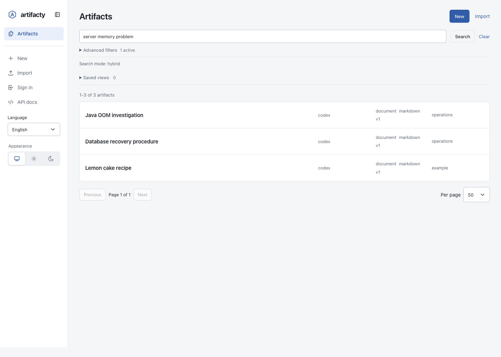

# Local models and semantic search

English | [한국어](ko/embeddings.md)

Semantic search helps find artifacts whose wording differs from your query. For example, a query about insufficient server memory can find an artifact about a Java OOM investigation. It ranks stored artifacts; it does not generate an answer or run a chat model.

The bundled model and `artifacty embeddings` commands described here are changes for the next release. They are not yet included in npm version `0.16.1`.

## Default model and data handling

Artifacty includes the INT8 ONNX weights and tokenizer for `intfloat/multilingual-e5-small`, pinned to revision `614241f622f53c4eeff9890bdc4f31cfecc418b3`. The weights occupy 118,346,824 bytes; the tokenizer and WebAssembly runtime add more space. Weights are packaged in chunks. Local inference runs as single-threaded CPU WebAssembly in a server-side Node.js worker without fetching models or sending document text or queries to an external server. Package installation still needs access to the package registry unless you prepare an offline installation.

Execution uses the `onnxruntime-web` WASM backend on the server, not in the browser. It needs no GPU, CUDA, or native Node.js addon. Runtime files come from the installed npm package; inference does not download them.

The upstream model uses the MIT license. ONNX Runtime uses MIT, and Hugging Face Tokenizers uses Apache-2.0. Artifacty includes the required notices; see [third-party notices](../THIRD_PARTY_NOTICES.md). These permissions do not automatically cover a replacement model: check its weights, tokenizer, runtime, and redistribution conditions separately.

The local provider loads its model when inference is first needed. The first request can take longer than later requests. CPU time and memory depend on the machine and document lengths. Do not treat the model file size as its peak RAM requirement. The worker releases its model after 60 seconds without requests; the next search loads it again.

The index uses artifact titles, tags, metadata, and supported text content. `ARTIFACTY_EMBEDDINGS_MAX_CHARS` limits content characters to 8,000 by default; the model also has a token limit. Long documents are truncated, so search does not represent every passage. Vectors remain in the SQLite store. Local inference does not encrypt the store or replace access controls.

## Verify and index an existing store

Use Node 24 for the commands below. Node 22.12 requires `NODE_OPTIONS=--experimental-sqlite` for Artifacty’s SQLite imports.

Run these commands with the same environment and `ARTIFACTY_HOME` as the server:

```bash
artifacty embeddings info
artifacty embeddings check
artifacty index rebuild --embeddings
```

`info` reports the selected configuration without running inference. `check` runs inference and checks the returned vectors. A successful check proves that the provider works on that machine; it does not measure retrieval quality for your documents. `index rebuild --embeddings` creates or refreshes vectors for existing artifacts. New and updated artifacts are indexed in the background, so they may not appear in semantic results immediately.

Restart a managed server after changing its environment. A shell `export` does not change the environment of an already running systemd, launchd, or other service. Apply the same provider configuration to local CLI and stdio MCP processes that share the store. A bridge MCP client uses the server's configuration.

## Search and verify results



The screenshot shows a search in an isolated example store. Open **Artifacts**, enter a query in **Search artifacts**, and select **Search**. By default, a nonempty query uses hybrid search, combining keyword and semantic rankings. Existing visibility permissions and filters still apply.

You can request a specific mode from the CLI:

```bash
artifacty list --query "server memory investigation" --mode semantic
artifacty list --query "server memory investigation" --mode hybrid
artifacty list --query "OOM" --mode keyword
```

The HTTP API accepts `GET /api/artifacts?q=...&mode=semantic`, and MCP `artifacty_list` accepts `query` and `mode`. If the provider fails or is disabled, semantic and hybrid requests fall back to keyword search and report `search.fallback: true`. Missing vectors are not evidence that an artifact does not exist: rebuild the embedding index and compare keyword results.

## Select a provider

| Setting | Result |
| --- | --- |
| No provider, command, or URL setting | Bundled local ONNX model |
| `ARTIFACTY_EMBEDDINGS_PROVIDER=local` | Bundled model, or the directory specified by `ARTIFACTY_EMBEDDINGS_LOCAL_PATH` |
| `ARTIFACTY_EMBEDDINGS_PROVIDER=command` | Executable specified by `ARTIFACTY_EMBEDDINGS_COMMAND` |
| `ARTIFACTY_EMBEDDINGS_PROVIDER=openai-compatible` | API specified by `ARTIFACTY_EMBEDDINGS_URL` |
| `ARTIFACTY_EMBEDDINGS_PROVIDER=disabled` | Keyword search only |

When `ARTIFACTY_EMBEDDINGS_PROVIDER` is unset, a configured command takes precedence over a configured URL. The bundled model is the fallback configuration only when neither is set. This preserves existing external integrations. To select the local model despite an old command or URL setting, explicitly set `ARTIFACTY_EMBEDDINGS_PROVIDER=local`.

For an external API:

```bash
export ARTIFACTY_EMBEDDINGS_PROVIDER=openai-compatible
export ARTIFACTY_EMBEDDINGS_URL=https://api.openai.com/v1
export ARTIFACTY_EMBEDDINGS_MODEL=text-embedding-3-small
# Set ARTIFACTY_EMBEDDINGS_API_KEY securely in the service environment.
artifacty embeddings check
```

Artifacty appends `/embeddings` to the base URL. The external provider receives indexed text and queries. Check its data handling and charges before enabling it. `ARTIFACTY_EMBEDDINGS_MODEL` selects an external API or command model; it does not download a local model.

A command provider reads one JSON line per text, `{ "text": "..." }`, on standard input and writes one `{ "embedding": [0.1, 0.2] }` line per vector on standard output. Configure an executable you trust; it runs with the Artifacty process's permissions.

## Change local models

Set `ARTIFACTY_EMBEDDINGS_PROVIDER=local` and `ARTIFACTY_EMBEDDINGS_LOCAL_PATH` to a local directory containing `embedding-model.json`, the compatible ONNX weights, and tokenizer files. This setting is an operator environment setting, not an administrator-page model picker. A chat model or an arbitrary ONNX graph is not necessarily compatible.

For a prepared model directory:

```bash
export ARTIFACTY_EMBEDDINGS_PROVIDER=local
export ARTIFACTY_EMBEDDINGS_LOCAL_PATH=/path/to/model-directory
artifacty embeddings check
artifacty index rebuild --embeddings
```

Local model identity includes its manifest digest. After changing model files or settings, run the check and rebuild commands with the new configuration. Artifacty retains previous vectors, but does not compare vectors from different local model identities. Keyword search remains available while the new index is populated; semantic coverage is incomplete until indexing finishes. To revert, restore the previous model configuration and restart the server. Do not delete old vectors as part of an ordinary model switch.

Prepare a replacement bundle with this manifest contract:

- `schemaVersion` is `1`; `id` and `license` are nonempty strings. Keep upstream source and revision information with the bundle.
- `dimensions` matches the output vector length (1–8,192), and `maxTokens` sets the sequence limit (2–8,192). The bundled model uses 384 dimensions and 512 tokens.
- `pooling` is `mean`, `cls`, or `sentence`; `normalize` must be `true`. Supply string `queryPrefix` and `documentPrefix` values, including empty strings where the model requires none. E5 uses `query: ` and `passage: `, respectively.
- `files` lists tokenizer assets. At minimum, include `tokenizer.json` and `tokenizer_config.json`. Each entry contains `path`, byte `size`, and lowercase hexadecimal `sha256`.
- `model.parts` lists one or more weight files in concatenation order, using the same file-entry fields. `model.size` and `model.sha256` describe the complete concatenated ONNX file. A single-file model still needs a one-entry `parts` array.
- File names must be unique, flat names containing only letters, digits, `_`, `-`, or `.`. Paths and symlinks must not escape the model directory. Keep the manifest and checksums synchronized with the files; integrity checks reject mismatches.

Use the installed `models/multilingual-e5-small/embedding-model.json` as the structural reference. Merely renaming another model or copying its weights into the default bundle is not sufficient. Match tokenizer behavior, graph inputs/outputs, pooling, dimensions, and prefixes to the replacement model, then run `artifacty embeddings check` and evaluate representative Korean and English searches before using it in production.
