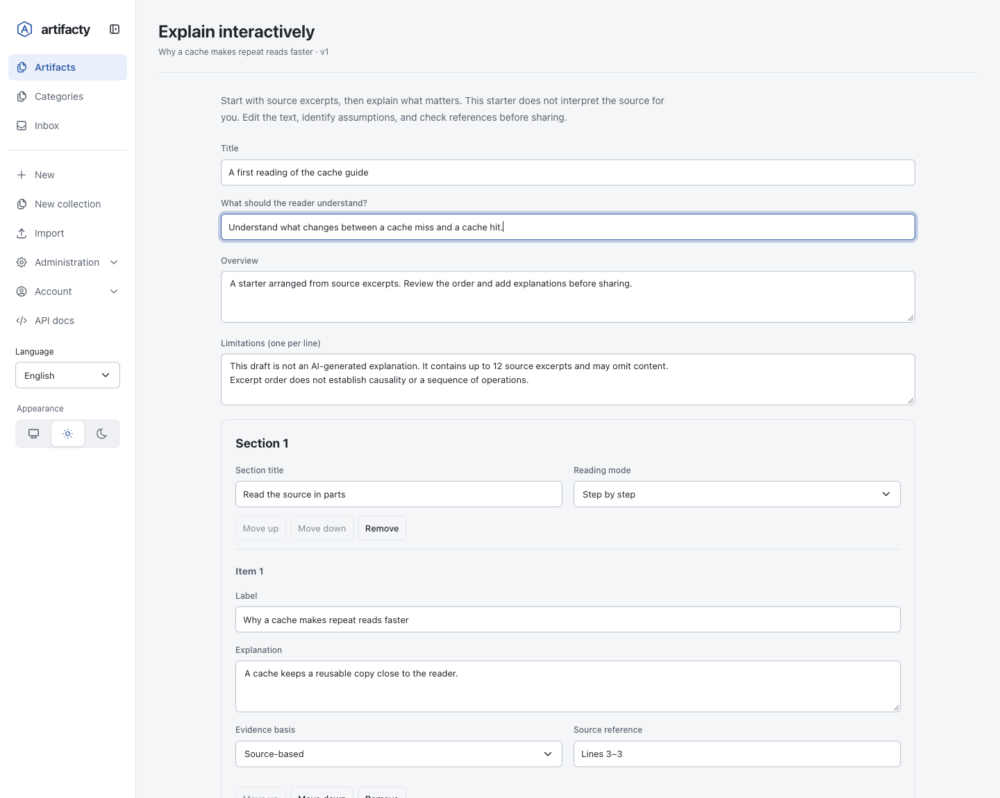
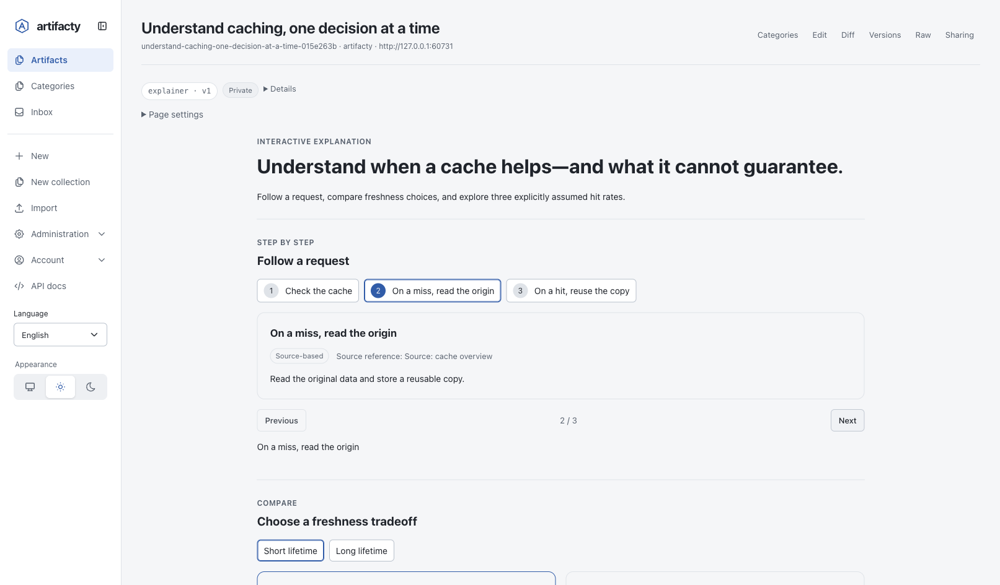
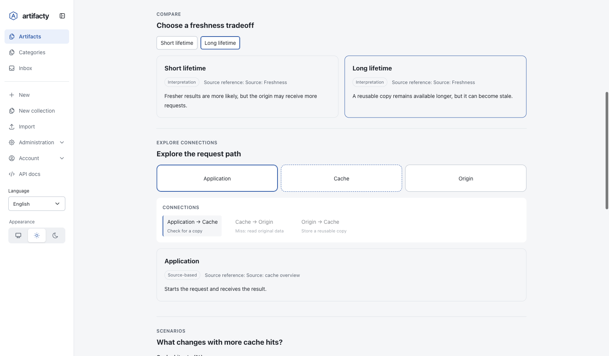
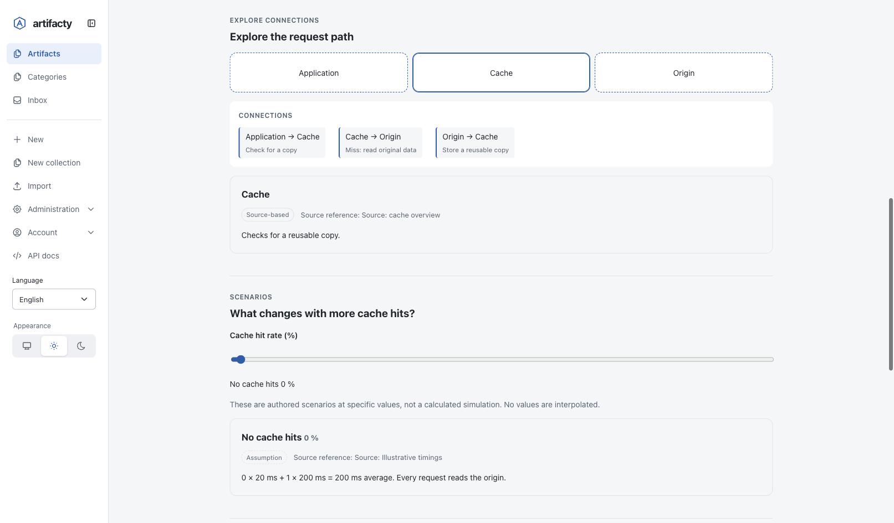
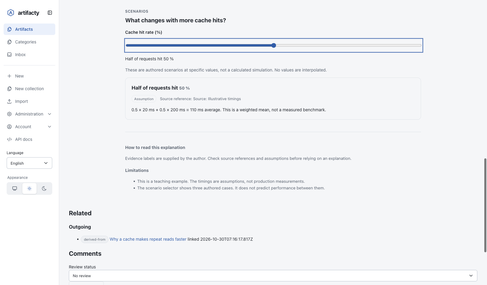
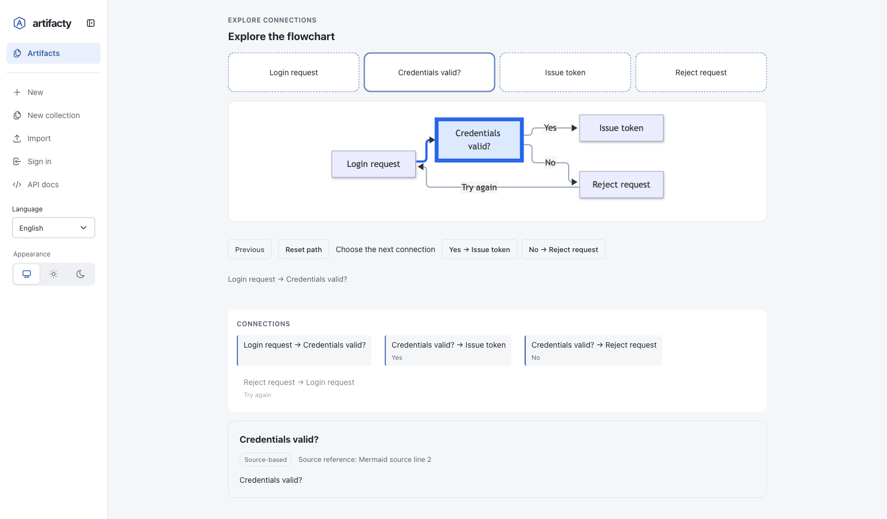

# Interactive explanations

English | [한국어](ko/interactive-explainers.md)

This feature is available in Artifacty 0.17.0 and later.

An explainer helps a reader work through existing content. It can reveal one step at a time, compare alternatives, explain connected elements, or show authored results for selected conditions. It is a separate artifact: creating one does not change the source.

Artifacty does not call a language model to interpret a figure. The browser starter arranges excerpts from Markdown or text. It can also import the supported subset of Mermaid flowcharts as connected elements. You or a connected agent write the explanation. The bundled ONNX embedding model supports search; it does not generate explainers.

## Create an explanation

The editor, comparison, and scenario screenshots show English UI in an isolated store with fictional data and a signed-in administrator. The flowchart screenshot uses a separate local store with no accounts.

1. Open the source artifact and the version you want to explain. Select **Explain interactively**.
2. Review the starter. Markdown and text sources can supply up to 12 excerpts with line references. Supported Mermaid flowcharts can supply a connected diagram draft. Other formats and unsupported Mermaid syntax require an authored explanation. An excerpt draft is not a summary of all source content, and its order does not establish causality.
3. Write the reader's goal and a short summary. Choose a mode for each block. Add, remove, or reorder blocks and items as needed.
4. For every item, write a label and explanation, then choose its evidence basis. Provide a source reference for items marked **Source-based**. Record limitations that affect interpretation.
5. Select **Create private explainer**. Check the result against the selected source version before sharing it.



The editor exposes the structured content as ordinary fields. Without JavaScript, it provides a JSON textarea instead. Saving creates an artifact; it does not automatically publish a draft. To revise a saved explainer, use the artifact's existing **Edit** workflow and save a new version.

## Choose an interaction that helps the reader

| Mode | Useful for | Reader interaction |
| --- | --- | --- |
| Step by step (`steps`) | A procedure, an argument, or a guided reading | Select an item or use previous/next controls. |
| Compare (`compare`) | Tradeoffs between alternatives | Read alternatives together and focus on the differences. |
| Explore connections (`diagram`) | Components and their relationships | Select an element and read its explanation and labeled connections. |
| Scenarios (`scenarios`) | Several documented or explicitly hypothetical conditions | Move between the values the author supplied. |



A step should answer a question or explain a transition. Splitting a paragraph into many controls does not necessarily make it clearer.



Keep alternatives visible together when their differences matter. Explain the tradeoff using the same criteria for each option.



Select a component to read its role. Labeled connections describe how it relates to the other elements; a connection does not by itself prove causality.



The scenario control selects discrete authored entries. It does not run a model, interpolate between points, or produce measurements. For example, a cache example can compare three hypothetical hit rates, but those numbers are not benchmark results. Label hypothetical values as assumptions and state their limits.

The viewer uses Artifacty's theme and keyboard-operable controls. Without JavaScript, all explanation items remain readable in sequence. Native explainer controls can also work in a permitted share preview; this does not enable arbitrary HTML scripts.

## Follow a flowchart

In the editor, select **Explore connections** for the block. Set **Diagram view** to **Interactive flowchart**, then choose **Layout direction** and **Starting node**. The diagram shows its authored elements and connections as a Mermaid flowchart. The existing connections define the available branches; Artifacty does not infer an execution order from the layout.

Select a node to read its explanation and evidence. Under **Choose the next connection**, select an outgoing connection to continue through the authored flow. Use **Previous** to return along your explored route or **Reset path** to return to the starting node. Selecting a node directly follows a connection when one exists from the current node; selecting another node starts a new route there. The highlighted route records the path you explored; it does not mean that the system executed those operations. Traversed arrows use moving dashes to show direction. With the system reduced-motion preference, the route stays highlighted without animation.



The selected decision exposes its **Yes** and **No** branches. The route below the controls records how the reader reached that node.

For a decision, label each outgoing connection with its condition. Explain the condition in the source or item text. For a loop, explain what allows the reader to leave it. A disconnected node can still be useful for reference, but it is not automatically part of the starting route.

The Mermaid starter accepts `flowchart` or `graph` with `LR`, `TB`, or `TD`; named nodes such as `A[Label]`, `B{Decision}`, and `C((End))`; and `-->` connections with optional `|label|` text. It supports chains, branches, and cycles. Unsupported constructs, including subgraphs, style or click directives, and other arrow types, fall back to manual authoring. The importer preserves labels and line references; it does not infer explanations or branch conditions.

This version supports flowchart exploration. Automatic sequence-diagram playback and C4 drill-down are not implemented. A connected agent can author a flowchart explanation from those sources, but must state what it simplified and preserve the source references.

## Make the evidence clear

Each item has one `basis` value:

- `source`: the author says the item is supported by the source. A nonempty `citation` is required, such as a line range, section, or figure label.
- `interpretation`: the author's explanation or inference from the material.
- `assumption`: a hypothetical condition or simplifying assumption.

These labels and citations are author declarations. Artifacty checks their structure, not their truth. Keep measured values distinct from examples. If the source does not support a numerical claim, omit it or clearly identify it as an assumption. The source link and the recorded source version help a reviewer check the explanation.

## Create through a connected agent

Use the MCP prompt `artifacty_explanation` with `artifactId` and an optional `goal` to prepare an authoring brief. The agent must read the source, choose a useful interaction, and check the resulting explanation. The prompt itself does not create an artifact or invoke another model.

The tool `artifacty_explain` takes `sourceId`, optional `sourceVersion`, optional `title`, an `explainer` object, and optional `provenance`. Omitting `sourceVersion` selects the latest version at creation time. For reproducible work, pass the version the agent read. For example, after reading version 1 of a source that states the request order:

```json
{
  "sourceId": "SOURCE_ARTIFACT_ID",
  "sourceVersion": 1,
  "title": "Follow a request through the cache",
  "explainer": {
    "schemaVersion": 1,
    "goal": "Understand where a request goes on a cache miss",
    "summary": "A short reading guide to the source's request path.",
    "limitations": ["This explains the request order, not measured latency."],
    "blocks": [{
      "id": "request-path",
      "title": "Request path",
      "type": "steps",
      "items": [{
        "id": "lookup",
        "label": "Check the cache",
        "explanation": "The request first checks the cache. On a miss, it continues to the origin.",
        "basis": "source",
        "citation": "Request path section, version 1"
      }]
    }]
  },
  "provenance": { "tool": "codex", "provider": "OpenAI" }
}
```

Replace the source ID and content with material actually read. Do not copy this citation onto an unrelated source. Omit unknown model details.

Existing CLI and JSON API creation also accept `format: "explainer"` with this object serialized as `content`. Generic creation does not automatically add a source relation or force private visibility; choose its permissions explicitly. The dedicated browser flow and `artifacty_explain` add a `derived-from` relation and record the selected source version and SHA-256 hash. The source remains unchanged.

## Sharing and source access

The dedicated creation flow creates a private artifact. On a server with accounts, use personal authentication and ensure you can read the source. A server with no accounts remains a local single-user store; private visibility is not a substitute for configuring authentication.

An explainer contains its own text, including any copied excerpts. Its content follows the explainer's permissions. Sharing it can therefore expose those excerpts even when the source stays private. Review the whole explanation before changing visibility or creating a share link.

Access to an explainer does not grant access to the source. Source relations are filtered by the reader's permissions. Existing server access mode, network restrictions, share-link expiry, and revocation still apply. Later source changes do not regenerate the explainer; check it and save a new version when needed.

## Structured format and limits

The format is declarative JSON, not JavaScript or HTML. Text is rendered as text. Unknown fields and unsupported schema versions are rejected.

- `schemaVersion` must be `1`; `goal` is required and supports up to 500 characters. Optional `summary` supports up to 5,000 characters.
- `limitations` contains up to 20 nonempty strings of up to 1,000 characters each.
- `blocks` contains 1–20 blocks. Each has a unique `id`, a `title` of up to 200 characters, a `type`, and `items`.
- A block contains 1–40 items; scenarios require at least two. The entire explainer supports up to 200 items. IDs use 1–80 ASCII letters, digits, underscores, or hyphens. Item IDs must be unique within their block.
- Each item has `id`, `label` (up to 200 characters), `explanation` (up to 10,000), and `basis`. Optional `citation` supports up to 1,000 characters and is required for `source` items.
- Only `diagram` blocks accept `connections`: up to 100 `{ "from", "to", "label" }` entries. Endpoints must be distinct item IDs in the same block. Duplicate directed connections are rejected. Labels are optional and support up to 200 characters.
- A `diagram` block can also include `diagram: { "direction": "LR", "start": "ITEM_ID" }` to enable flowchart navigation. `direction` is `LR` or `TB`, and `start` must name an item in that block. Both fields are required when `diagram` is present. Omitting it preserves the existing connection explorer.
- Only `scenarios` blocks accept `parameter: { "label", "unit" }` and item `value` numbers. Parameter labels support up to 200 characters; optional units support up to 40. Values must be finite and strictly increasing in item order.

## Verify your explanation

Open every step and diagram element. Compare the alternatives. Move the scenario control to both ends and check the displayed value and explanation. Confirm that evidence labels and limitations match the source. Test the result at a narrow width and with the keyboard. Before sharing, view it with the intended recipient's access; an administrator may be able to read more than that recipient.

To try the feature without using real data, install the English sample **Interactive explanations — cache tradeoffs** with `artifacty samples install`. It includes all four modes and identifies its scenario values as fictional assumptions. Reinstalling samples preserves edits to previously installed manuals; it does not rewrite them with updated documentation.
