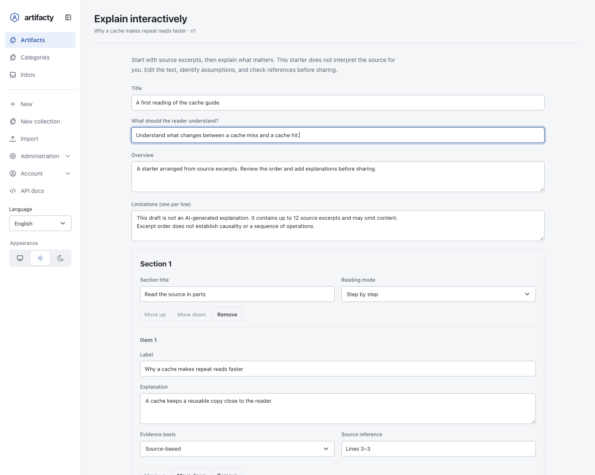
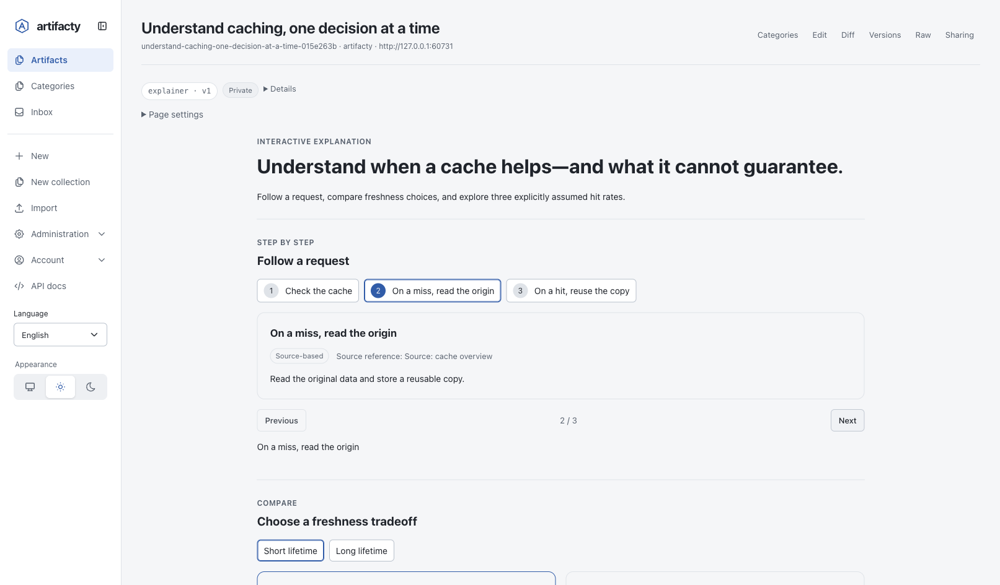
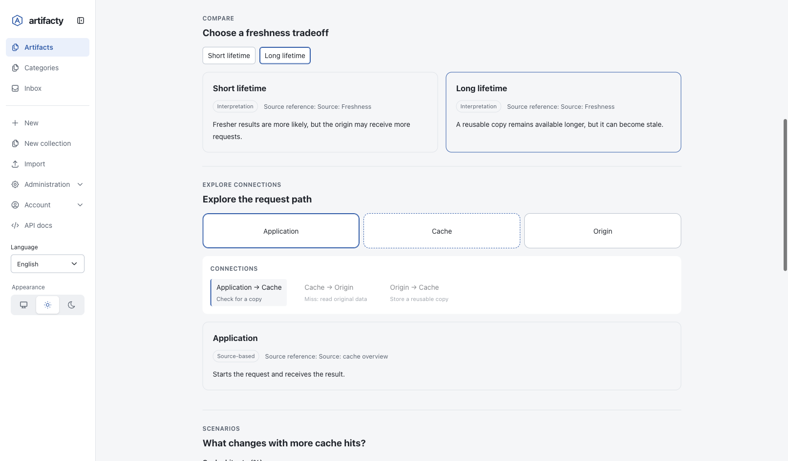
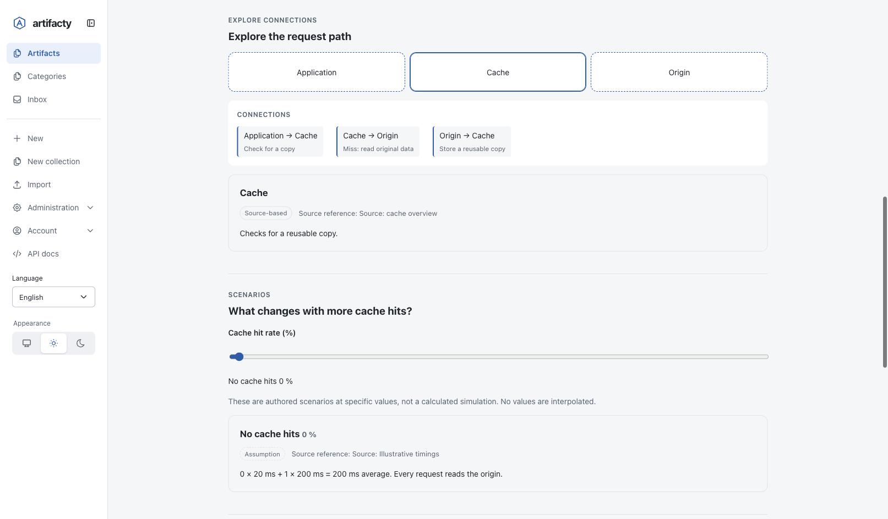
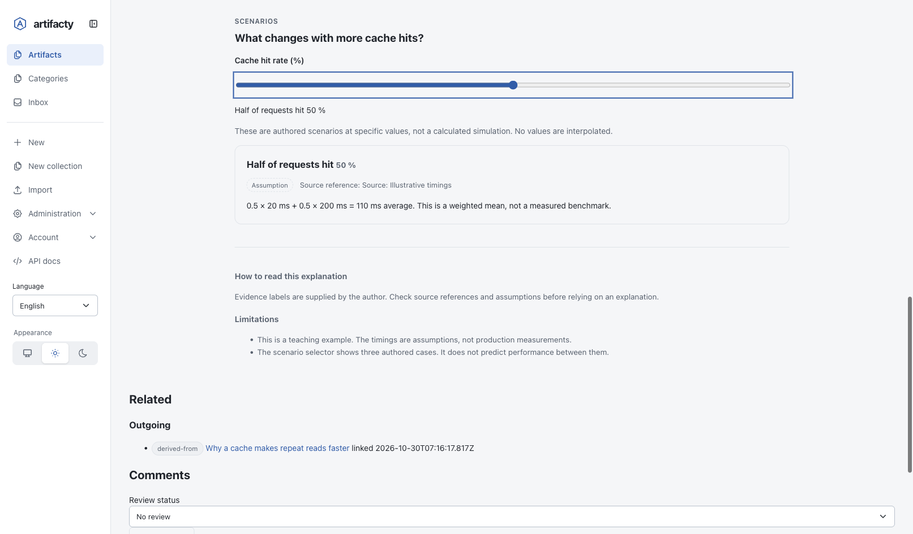
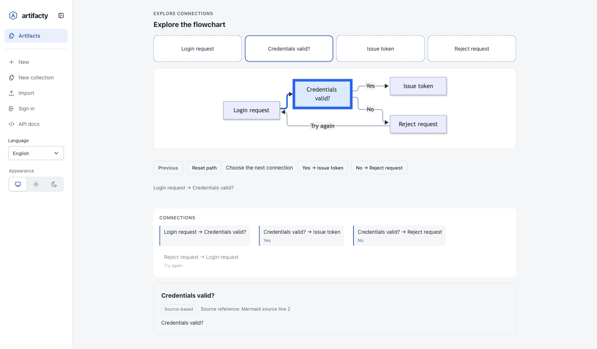

# 인터랙티브 설명

[English](../interactive-explainers.md) | 한국어

<!-- 원문 대조: 2026-10-30, 영문 동시 개정본 -->

이 기능은 Artifacty 0.17.0부터 사용할 수 있습니다.

인터랙티브 설명은 기존 내용을 직접 살펴보며 이해하도록 돕는 아티팩트입니다. 단계를 하나씩 따라가거나, 대안을 비교하거나, 연결된 요소의 의미를 확인하거나, 조건별로 작성된 결과를 볼 수 있습니다. 원본과 별도로 생성하므로 원본 내용은 바뀌지 않습니다.

Artifacty가 언어 모델을 호출해 그림을 해석하는 기능은 아닙니다. 브라우저의 초기 초안은 Markdown이나 텍스트에서 발췌한 내용을 배열합니다. 지원하는 Mermaid 플로우차트 문법은 연결된 요소로 가져올 수도 있습니다. 설명은 사용자나 연결된 에이전트가 작성합니다. 기본 ONNX 임베딩 모델은 검색에 사용하며 설명을 생성하지 않습니다.

## 설명 만들기

편집기·비교·시나리오 스크린샷은 가상 데이터를 넣은 별도 저장소에서 관리자로 로그인하고 영어 UI로 촬영했습니다. 플로우차트 스크린샷은 계정이 없는 별도 로컬 저장소에서 촬영했습니다.

1. 설명할 원본 아티팩트와 버전을 열고 **Explain interactively**를 선택하세요.
2. 초안을 확인하세요. Markdown과 텍스트에서는 줄 번호가 표시된 발췌문을 최대 12개 제공합니다. 지원하는 Mermaid 플로우차트는 연결된 도식 초안을 제공합니다. 다른 형식이나 지원하지 않는 Mermaid 문법은 설명을 직접 작성해야 합니다. 발췌 초안은 원본 전체의 요약이 아니며, 나열된 순서가 인과관계를 뜻하지도 않습니다.
3. 독자가 이해할 목표와 짧은 요약을 작성하세요. 블록별 표시 방식을 고르고, 필요한 블록과 항목을 추가·삭제하거나 순서를 바꾸세요.
4. 각 항목의 제목과 설명을 작성한 뒤 근거 유형을 고르세요. **Source-based**로 표시한 항목에는 출처를 적고, 해석에 영향을 주는 한계도 기록하세요.
5. **Create private explainer**를 선택하세요. 공유하기 전에 선택한 원본 버전과 결과를 대조하세요.



편집기는 구조화된 콘텐츠를 일반 입력란으로 제공합니다. JavaScript를 사용할 수 없으면 JSON 텍스트 영역을 제공합니다. 저장은 아티팩트를 만드는 동작이며 초안을 자동 공개하지 않습니다. 저장한 설명을 수정하려면 기존 **Edit** 기능으로 편집하고 새 버전을 저장하세요.

## 이해에 도움이 되는 방식을 고르기

| 방식 | 적합한 내용 | 독자가 하는 동작 |
| --- | --- | --- |
| Step by step (`steps`) | 절차, 논증, 순서대로 읽을 내용 | 항목을 선택하거나 이전·다음 버튼으로 이동합니다. |
| Compare (`compare`) | 대안별 장단점 | 대안을 함께 읽으며 차이를 확인합니다. |
| Explore connections (`diagram`) | 구성요소와 관계 | 요소를 선택하고 설명과 연결 관계를 읽습니다. |
| Scenarios (`scenarios`) | 기록된 조건 또는 명시적인 가정에 따른 예시 | 작성자가 제공한 값 사이를 이동합니다. |



각 단계는 질문에 답하거나 다음 단계로 넘어가는 이유를 설명해야 합니다. 문단을 잘게 나누고 버튼을 늘리는 것만으로 이해하기 쉬워지지는 않습니다.



차이를 확인해야 할 때는 대안을 함께 보여 주세요. 각 대안에 같은 기준을 적용해 장단점을 설명하세요.



구성요소를 선택하면 역할을 읽을 수 있습니다. 연결 이름은 다른 요소와 어떤 관계인지 설명하며, 연결 자체가 인과관계를 입증하지는 않습니다.



시나리오 조절기는 작성된 항목을 선택합니다. 모델을 실행하거나 표본 사이의 값을 계산하거나 측정 결과를 만들지는 않습니다. 예를 들어 캐시 적중률 세 가지를 가정해 비교할 수 있지만, 그 값은 벤치마크 결과가 아닙니다. 가상의 수치는 가정으로 표시하고 적용 한계를 적으세요.

뷰어는 Artifacty의 테마를 따르며 키보드로 조작할 수 있습니다. JavaScript를 사용할 수 없어도 모든 설명 항목을 순서대로 읽을 수 있습니다. 허용된 공유 미리보기에서도 기본 설명 컨트롤을 사용할 수 있지만, 임의 HTML 스크립트를 허용하는 것은 아닙니다.

## 플로우차트 따라가기

편집기에서 블록 유형을 **Explore connections**로 고르세요. **Diagram view**를 **Interactive flowchart**로 바꾸고 **Layout direction**과 **Starting node**를 지정하세요. 작성한 요소와 연결을 Mermaid 플로우차트로 볼 수 있습니다. 이동할 수 있는 분기는 작성된 연결로 정하며, Artifacty가 배치만 보고 실행 순서를 추측하지는 않습니다.

노드를 선택하면 설명과 근거를 읽을 수 있습니다. **Choose the next connection**에서 현재 노드의 다음 연결을 골라 흐름을 따라가세요. **Previous**로 탐색 경로의 이전 지점에 돌아가고, **Reset path**로 시작 노드에 돌아갑니다. 노드를 직접 선택하면 현재 노드에서 연결된 경우 해당 경로를 따라갑니다. 연결되지 않은 노드를 고르면 그 지점에서 새 경로를 시작합니다. 강조된 경로는 독자가 탐색한 순서이며, 시스템이 실제로 실행한 작업을 뜻하지 않습니다. 지나온 화살표의 점선이 이동 방향을 보여 줍니다. 시스템에서 동작 줄이기를 설정하면 애니메이션 없이 경로만 강조합니다.



결정 노드를 선택하면 **Yes**와 **No** 분기가 나타납니다. 버튼 아래의 경로는 독자가 그 노드까지 이동한 순서를 보여 줍니다.

분기에는 각 연결의 조건을 적고, 원문이나 항목 설명에서 그 조건을 설명하세요. 반복 구간에는 어떤 조건에서 벗어나는지도 적으세요. 연결되지 않은 노드를 참고용으로 넣을 수 있지만 시작 경로에 자동으로 포함되지는 않습니다.

Mermaid 초안은 `flowchart` 또는 `graph`의 `LR`, `TB`, `TD` 방향, `A[Label]`, `B{Decision}`, `C((End))` 같은 노드, `-->` 연결과 선택적인 `|label|` 문구를 지원합니다. 연속 연결, 분기, 순환 경로도 가져올 수 있습니다. 하위 그래프, 스타일·클릭 지시문, 다른 화살표 문법 등은 지원하지 않으며 직접 작성하는 초안으로 전환합니다. 가져오기는 제목과 줄 번호를 보존하며, 설명이나 분기 조건을 추측하지 않습니다.

이 버전은 플로우차트 탐색을 지원합니다. 시퀀스 다이어그램 자동 재생과 C4 단계별 확장은 아직 구현되지 않았습니다. 연결된 에이전트가 해당 자료를 바탕으로 플로우차트 설명을 작성할 수는 있지만, 단순화한 부분과 원문 출처를 밝혀야 합니다.

## 근거를 분명하게 표시하기

각 항목의 `basis`는 다음 중 하나입니다.

- `source`: 원본이 뒷받침하는 내용이라고 작성자가 선언한 항목입니다. 줄 범위, 절 제목, 그림 번호 등 비어 있지 않은 `citation`이 필요합니다.
- `interpretation`: 작성자가 자료를 바탕으로 덧붙인 설명이나 추론입니다.
- `assumption`: 가상의 조건이나 이해를 돕기 위한 단순화 가정입니다.

이 표시와 출처는 작성자의 선언입니다. Artifacty는 형식을 검증하지만 사실 여부까지 검증하지는 않습니다. 측정값과 예시를 구분하세요. 원본이 뒷받침하지 않는 수치 주장은 빼거나 가정임을 명확히 표시하세요. 검토자는 원본 링크와 기록된 원본 버전으로 설명을 확인할 수 있습니다.

## 연결된 에이전트로 만들기

MCP 프롬프트 `artifacty_explanation`에 `artifactId`와 선택적인 `goal`을 전달하면 작성 지침을 준비할 수 있습니다. 에이전트는 원본을 읽고 적절한 표시 방식을 선택한 뒤 설명을 확인해야 합니다. 프롬프트 자체가 아티팩트를 만들거나 다른 모델을 호출하지는 않습니다.

`artifacty_explain` 도구에는 `sourceId`, 선택적인 `sourceVersion`과 `title`, `explainer` 객체, 선택적인 `provenance`를 전달합니다. `sourceVersion`을 생략하면 생성 시점의 최신 버전을 사용합니다. 같은 원본을 기준으로 검토하려면 에이전트가 읽은 버전을 지정하세요. 다음은 요청 순서가 명시된 원본의 1번 버전을 읽은 뒤 사용하는 예시입니다.

```json
{
  "sourceId": "SOURCE_ARTIFACT_ID",
  "sourceVersion": 1,
  "title": "Follow a request through the cache",
  "explainer": {
    "schemaVersion": 1,
    "goal": "Understand where a request goes on a cache miss",
    "summary": "A short reading guide to the source's request path.",
    "limitations": ["This explains the request order, not measured latency."],
    "blocks": [{
      "id": "request-path",
      "title": "Request path",
      "type": "steps",
      "items": [{
        "id": "lookup",
        "label": "Check the cache",
        "explanation": "The request first checks the cache. On a miss, it continues to the origin.",
        "basis": "source",
        "citation": "Request path section, version 1"
      }]
    }]
  },
  "provenance": { "tool": "codex", "provider": "OpenAI" }
}
```

원본 ID와 내용은 실제로 읽은 자료에 맞게 바꾸세요. 이 출처 표기를 관련 없는 원본에 그대로 사용하지 마세요. 모르는 모델 정보는 생략하세요.

기존 CLI와 JSON API에서도 `format: "explainer"`를 지정하고 이 객체를 문자열로 직렬화해 `content`로 전달할 수 있습니다. 일반 생성 경로는 원본 관계를 자동 추가하거나 비공개를 강제하지 않으므로 권한을 명시적으로 선택하세요. 전용 브라우저 기능과 `artifacty_explain`은 `derived-from` 관계를 추가하고 선택한 원본 버전과 SHA-256 해시를 기록합니다. 원본은 바뀌지 않습니다.

## 공유와 원본 접근 권한

전용 생성 기능은 비공개 아티팩트를 만듭니다. 계정이 있는 서버에서는 개인 인증을 사용해야 하며 원본을 읽을 권한도 필요합니다. 계정이 없는 서버는 로컬 단일 사용자 저장소이므로, 비공개 설정만으로 인증 구성을 대신할 수는 없습니다.

설명 아티팩트는 복사한 발췌문을 포함해 자체 콘텐츠를 저장하며, 그 내용에는 설명 아티팩트의 권한이 적용됩니다. 따라서 원본을 비공개로 유지해도 설명을 공유하면 발췌문이 공개될 수 있습니다. 공개 범위를 바꾸거나 공유 링크를 만들기 전에 설명 전체를 확인하세요.

설명에 접근할 수 있어도 원본을 읽을 권한까지 생기지는 않습니다. 원본 관계는 독자의 권한에 따라 표시합니다. 기존 서버 접근 모드, 네트워크 제한, 공유 링크 만료와 취소 규칙도 적용됩니다. 원본이 나중에 바뀌어도 설명은 자동 재생성되지 않습니다. 변경 내용을 검토하고 필요하면 새 버전을 저장하세요.

## 구조와 제한

콘텐츠 형식은 선언형 JSON이며 JavaScript나 HTML이 아닙니다. 입력한 텍스트는 텍스트로 표시합니다. 알 수 없는 필드와 지원하지 않는 스키마 버전은 거부합니다.

- `schemaVersion`은 `1`이어야 합니다. 필수 `goal`은 최대 500자, 선택적인 `summary`는 최대 5,000자입니다.
- `limitations`에는 비어 있지 않은 문자열을 최대 20개 넣을 수 있으며 각각 최대 1,000자입니다.
- `blocks`에는 블록을 1~20개 넣습니다. 각 블록에는 고유한 `id`, 최대 200자의 `title`, `type`, `items`가 있습니다.
- 블록마다 항목을 1~40개 넣을 수 있으며 시나리오는 최소 2개가 필요합니다. 전체 항목은 최대 200개입니다. ID는 ASCII 영문자, 숫자, 밑줄, 하이픈으로 된 1~80자이며 항목 ID는 블록 안에서 고유해야 합니다.
- 각 항목에는 `id`, 최대 200자의 `label`, 최대 10,000자의 `explanation`, `basis`가 있습니다. 선택적인 `citation`은 최대 1,000자이며 `source` 항목에는 필수입니다.
- `diagram` 블록에만 `connections`를 지정할 수 있습니다. `{ "from", "to", "label" }`을 최대 100개 넣으며, 양 끝은 같은 블록의 서로 다른 항목 ID여야 합니다. 같은 방향의 중복 연결은 거부합니다. 선택적인 연결 제목은 최대 200자입니다.
- `diagram` 블록에 `diagram: { "direction": "LR", "start": "ITEM_ID" }`을 추가하면 플로우차트 탐색을 켭니다. `direction`은 `LR` 또는 `TB`이며 `start`는 같은 블록의 항목 ID여야 합니다. `diagram`을 지정하면 두 필드는 모두 필수입니다. 생략하면 기존 연결 탐색 보기를 유지합니다.
- `scenarios` 블록에만 `parameter: { "label", "unit" }`과 항목별 숫자 `value`를 지정할 수 있습니다. 매개변수 제목은 최대 200자, 선택적인 단위는 최대 40자입니다. 값은 유한해야 하며 항목 순서대로 엄격한 오름차순이어야 합니다.

## 결과 확인하기

모든 단계와 관계도 요소를 열어 보고 대안을 비교하세요. 시나리오 조절기를 양 끝으로 이동해 값과 설명이 맞는지 확인하세요. 근거 표시와 한계가 원본에 부합하는지 대조하고, 좁은 화면과 키보드로도 조작해 보세요. 공유 전에는 실제 받는 사람의 권한으로 확인하세요. 관리자는 받는 사람보다 더 많은 내용을 볼 수 있습니다.

실제 자료 없이 기능을 시험하려면 `artifacty samples install`로 영문 샘플 **Interactive explanations — cache tradeoffs**를 설치하세요. 네 가지 방식을 모두 포함하며, 시나리오 값은 가상의 가정으로 표시합니다. 샘플을 다시 설치해도 이미 설치한 매뉴얼의 수정 내용은 보존되며 최신 문서로 덮어쓰지 않습니다.
