# 브라우저 사용 매뉴얼

[English](../user-guide.md) | 한국어

<!-- 번역 기준: 2026-10-20 영문 user-guide.md 동시 작성본 -->

이 매뉴얼은 Artifacty 브라우저 화면의 기본 사용법을 안내합니다. [README](../../README.ko.md)에 따라 서버를 설치하고 시작한 뒤, 서버가 출력한 주소를 여세요.

스크린샷은 로컬 단일 사용자 서버에서 예시 데이터와 영어 UI로 촬영했습니다. 공유 서버에서는 로그인이 필요할 수 있으며, 권한에 따라 사용할 수 있는 기능이 다릅니다. 추가 기능별 스크린샷은 별도의 비공개 테스트 서버에서 가상의 관리자 계정으로 촬영했습니다. 두 언어의 매뉴얼은 같은 영어 스크린샷을 사용합니다. 설정 화면은 외부 이메일 전송이나 서버 업데이트 실행을 입증하지 않습니다. 화면 언어를 바꿔도 아티팩트 내용은 번역되지 않습니다. 아래 영문 버튼 이름은 스크린샷에서 해당 기능을 찾기 위한 표기입니다.

기능 바로가기: [아티팩트 찾기](#아티팩트-찾기) · [아티팩트 생성과 편집](#아티팩트-생성과-편집) · [콘텐츠 미리보기](#콘텐츠-미리보기) · [이전 버전과 변경 비교](#이전-버전과-변경-비교) · [공유와 검토](#공유와-검토) · [관리 기능과 화면 설정](#관리-기능과-화면-설정) · [작업 결과 확인](#작업-결과-확인)

## 아티팩트 찾기

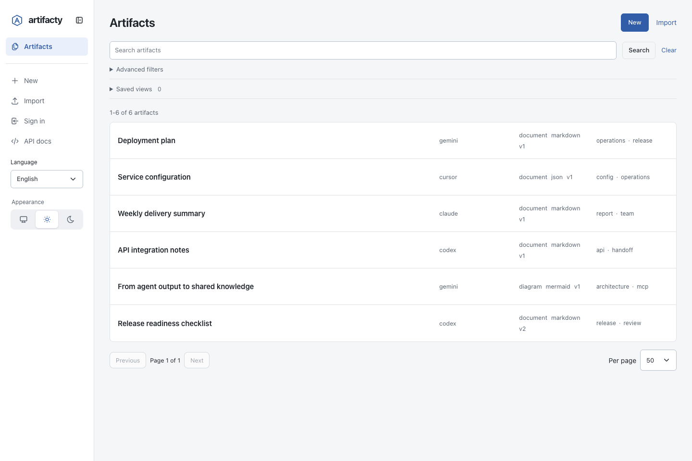

1. 사이드바에서 **Artifacts**를 여세요.
2. **Search artifacts**에 검색어를 입력하고 **Search**를 선택하세요.
3. **Advanced filters**를 열어 태그, 출처, 유형, 게시자, 날짜 또는 검토 상태로 결과를 좁히세요. JavaScript를 사용할 수 있으면 필터를 변경할 때 바로 적용됩니다. 조건을 초기화하려면 **Clear**를 선택하세요.
4. 아티팩트 제목을 선택해 내용을 여세요.

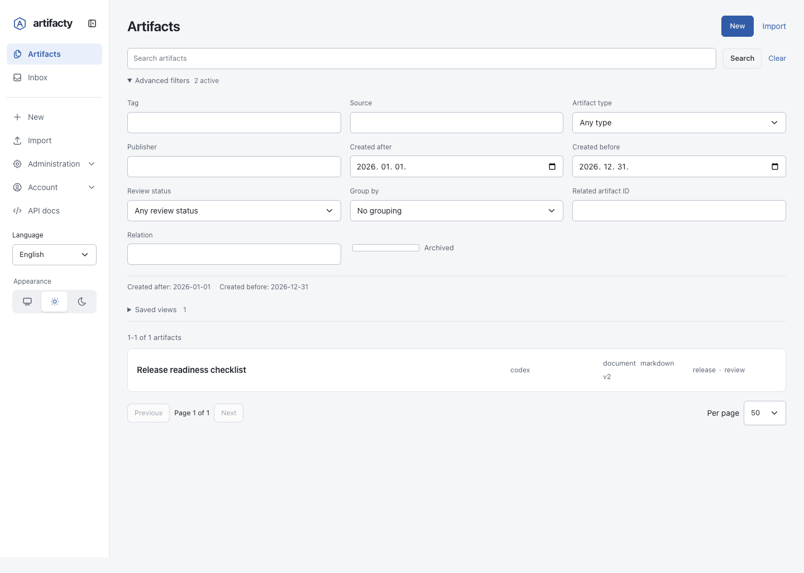

목록 하단의 **Previous**와 **Next**로 페이지를 이동합니다. **Per page**에서는 페이지당 10개, 25개, 50개 또는 100개를 선택할 수 있습니다. JavaScript를 사용할 수 있으면 선택 즉시 적용됩니다. 결과 개수를 확인해 필터와 페이지 변경이 반영되었는지 확인하세요.

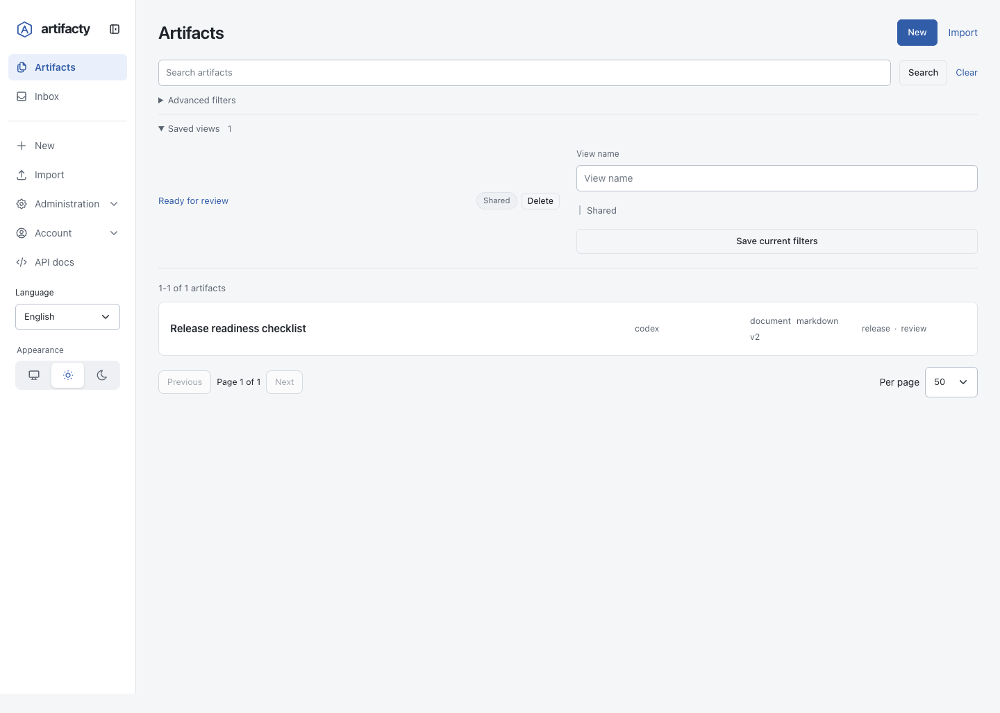

필터를 다시 사용하려면 **Saved views**에서 이름을 정해 저장하세요. 뷰를 저장하려면 저장 버튼을 눌러야 합니다. 필터를 바꿔도 기존 뷰를 덮어쓰지 않습니다. 필터는 표시할 결과만 바꾸며 아티팩트 자체는 변경하지 않습니다.

## 아티팩트 생성과 편집

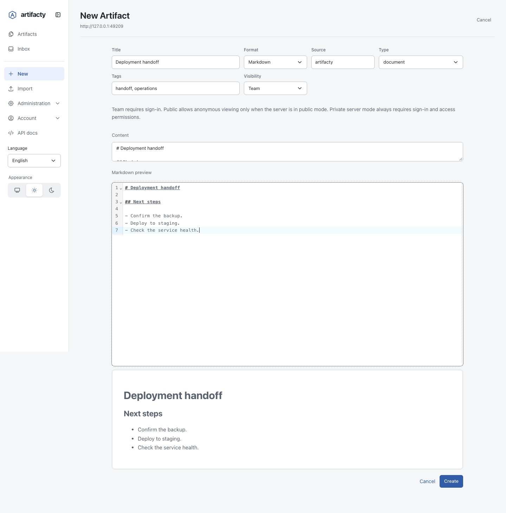

1. 목록에서 **New**를 선택하세요.
2. 제목과 콘텐츠 형식을 지정하고, 필요하면 출처, 유형과 태그를 입력하세요.
3. 공개 범위를 선택하고 내용을 입력하세요.
4. **Create**를 선택하세요. 뷰어가 열리면 제목과 내용이 올바른지 확인하세요.

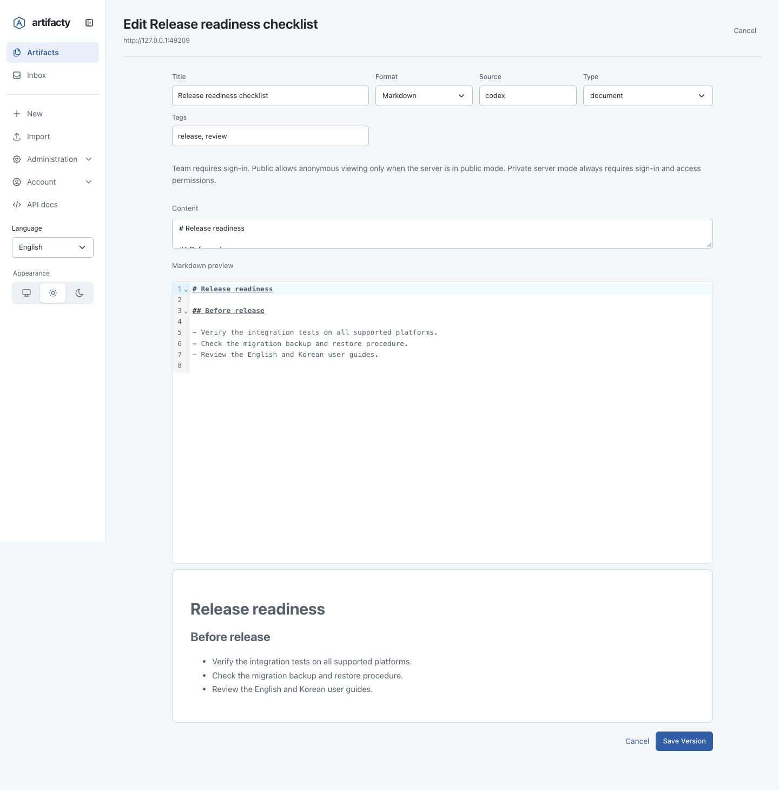

기존 아티팩트는 뷰어의 **Edit**로 편집합니다. 편집을 마치면 **Save Version**을 선택하세요. 편집 내용은 자동 저장되지 않습니다. 저장한 뒤 새 버전 번호가 표시되는지 확인하세요. 편집하는 동안 다른 사용자가 새 버전을 저장했다면, 충돌 안내와 변경 비교를 확인한 뒤 다시 저장하세요.

아티팩트 공개 범위와 서버 접근 모드는 별개입니다. 서버가 비공개 모드이면 공개 아티팩트에도 로그인과 공유 권한 제한이 적용됩니다. 소유자와 관리자는 뷰어에서 공개 범위를 변경할 수 있습니다. 전체 권한 규칙은 [README](../../README.ko.md)를 참고하세요.

## 콘텐츠 미리보기

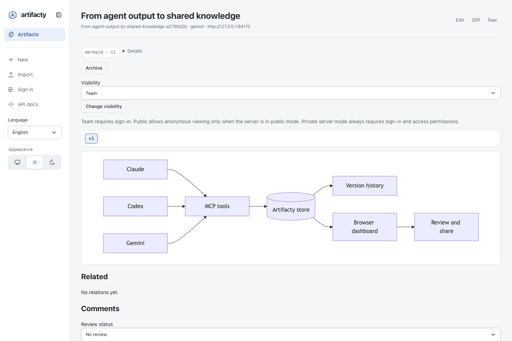

뷰어는 저장된 형식에 맞는 미리보기를 표시합니다. Markdown에는 Mermaid 코드 블록을 넣을 수 있습니다. HTML, SVG, 코드, JSON, CSV, SARIF, 노트북과 미디어 등도 지원합니다. 미리보기 범위는 형식과 서버 설정에 따라 달라집니다. 저장된 원문은 **Raw**에서 확인하세요.

HTML은 샌드박스 프레임에서 실행됩니다. 공개 공유 링크에서는 더 엄격한 제한을 적용합니다. HTML의 스크립트와 외부 리소스를 차단하며, React·노트북·SVG·Mermaid 아티팩트는 실행 화면 대신 소스를 표시합니다. 따라서 공개 공유 링크의 화면이 로그인한 사용자의 뷰어와 같다고 가정하면 안 됩니다.

## 이전 버전과 변경 비교

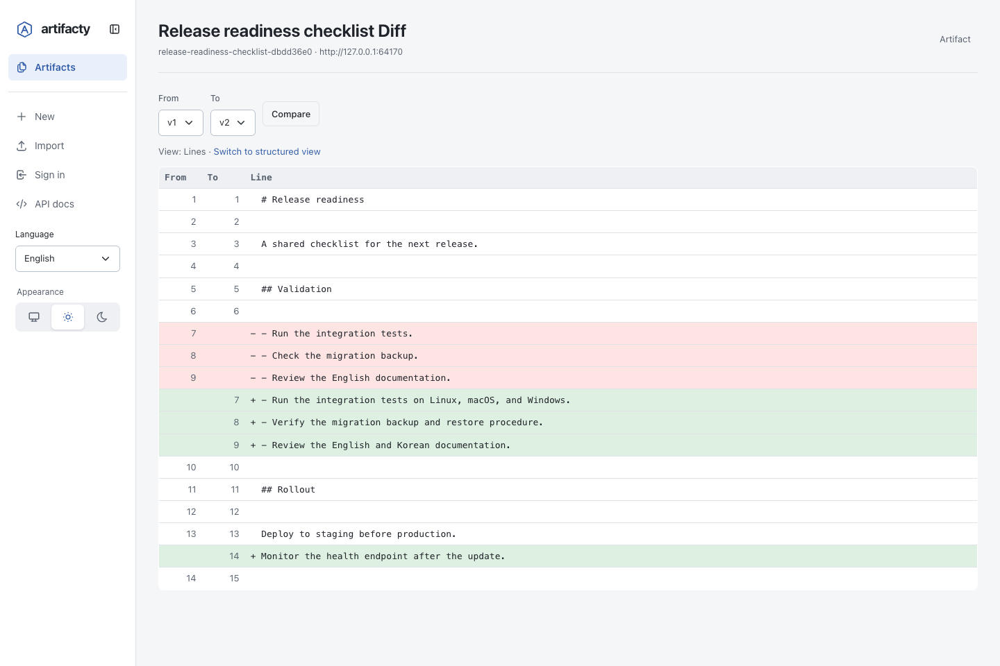

1. 아티팩트를 열고 버전 목록에서 **v1**, **v2** 등 원하는 버전을 선택하세요.
2. 내용을 읽거나 복사하기 전에 표시된 버전 번호를 확인하세요.
3. **Diff**를 열고 **From**과 **To**에서 비교할 버전을 선택한 뒤 **Compare**를 누르세요.
4. 변경 내용을 확인하세요. 지원되는 형식에서는 구조 비교와 줄 비교를 전환할 수 있습니다.

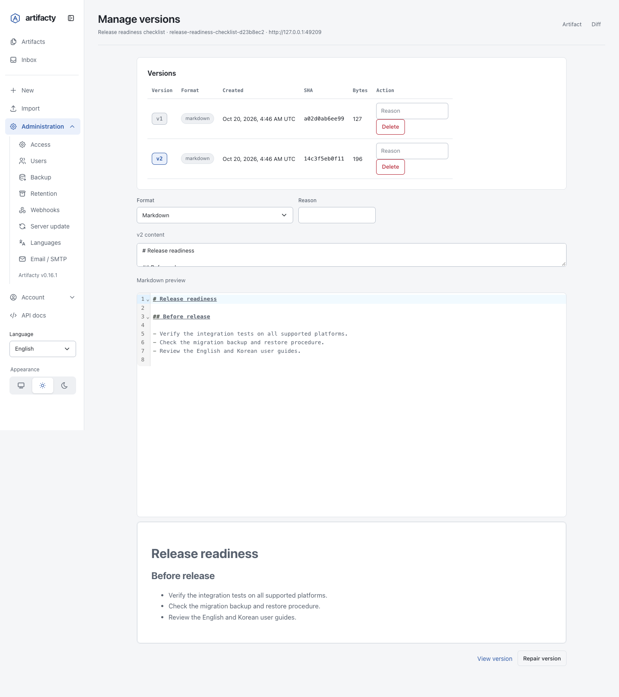

이전 버전을 열어도 해당 버전으로 복원되거나 새 버전이 삭제되지는 않습니다. **Versions**는 관리자의 버전 유지 관리 기능이며, 이전 버전을 읽을 때 사용할 필요는 없습니다. 백업과 복구는 [업데이트 백업과 복구](upgrade-backups.md)를 참고하세요.

## 공유와 검토

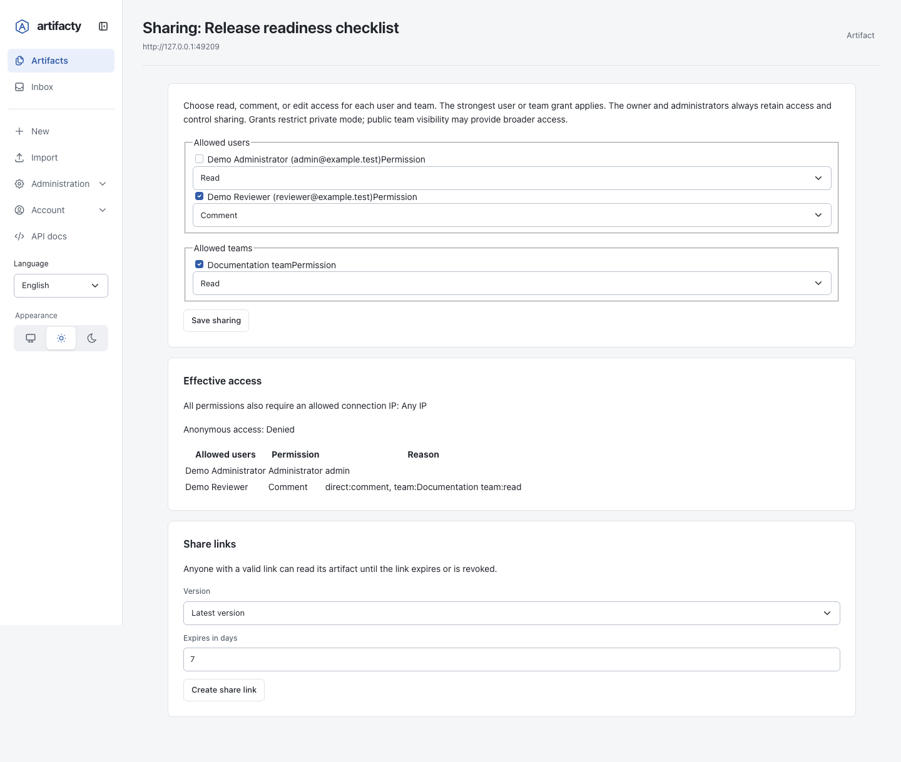

공유 서버에서는 아티팩트 소유자나 관리자가 **Sharing**을 열 수 있습니다. 사용자 또는 팀을 선택하고 읽기·댓글·편집 권한을 지정한 뒤 공유 설정을 저장하세요. 수신자의 계정으로 접근할 수 있는지 확인하세요. 관리자 계정에서 열리는 것만으로 수신자의 접근 권한을 검증할 수는 없습니다.

공유 링크는 선택한 버전이나 최신 버전을 읽기 전용으로 제공합니다. 만료 기간을 정해 링크를 생성하고 바로 복사하세요. 전체 토큰은 생성 직후에만 표시됩니다. 더 이상 필요하지 않은 링크는 폐기하세요. 비공개 서버에서는 관리자가 허용하기 전까지 기본적으로 공유 링크를 사용할 수 없습니다.

관리자가 공유 링크 예외를 활성화하지 않았다면 IP 제한도 적용됩니다. 이 예외는 유효한 공유 링크와 해당 원문에만 적용되며, 차단된 IP 대역에 대시보드·API·MCP를 개방하지 않습니다. 자세한 내용은 [네트워크 공유](network-sharing.md)를 참고하세요.

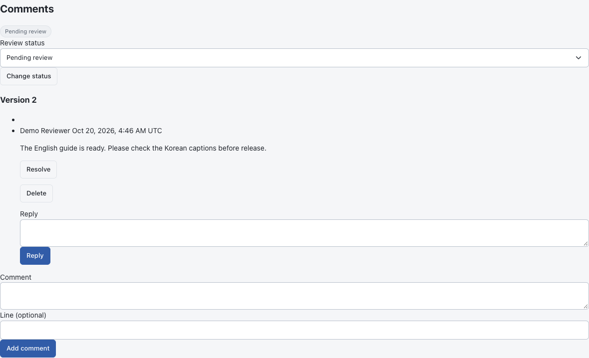

댓글로 특정 아티팩트 버전에 대한 의견을 나눌 수 있습니다. **Review status**는 **No review**(검토 없음), **Pending review**(검토 대기 중), **Changes requested**(수정 요청됨), **Approved**(승인됨) 상태를 기록합니다. 소유자나 관리자는 상태를 선택하고 **Change status**로 변경합니다. 검토 상태는 검토가 필요한 작업을 찾기 위한 표시입니다. 접근 권한을 부여하거나 내용을 공개하는 기능은 아닙니다. 변경한 상태가 뷰어 또는 목록 필터에 반영되는지 확인하세요.

## 관리 기능과 화면 설정

관리자에게는 사이드바의 **Administration** 아래에 서버 관리 메뉴가 표시됩니다.

| 작업 | 시작 위치 |
| --- | --- |
| 공개·비공개 모드, IP 제한과 공유 링크 정책 관리 | 접근 설정; [네트워크 공유](network-sharing.md), [README](../../README.ko.md) |
| 사용자, 역할과 비밀번호 재설정 관리 | Users; [SMTP와 비밀번호 재설정](smtp.md) |
| 서버 업데이트 확인, 백업 점검과 복구 | Update와 Backup; [업데이트 백업과 복구](upgrade-backups.md) |
| 사용할 화면 언어와 기본 언어 지정 | [언어 팩](language-packs.md) |
| HTTP API와 예제 확인 | 사이드바의 **API docs** |
| 로컬 에이전트의 MCP 연결 | [에이전트 연동](integrations.md) |

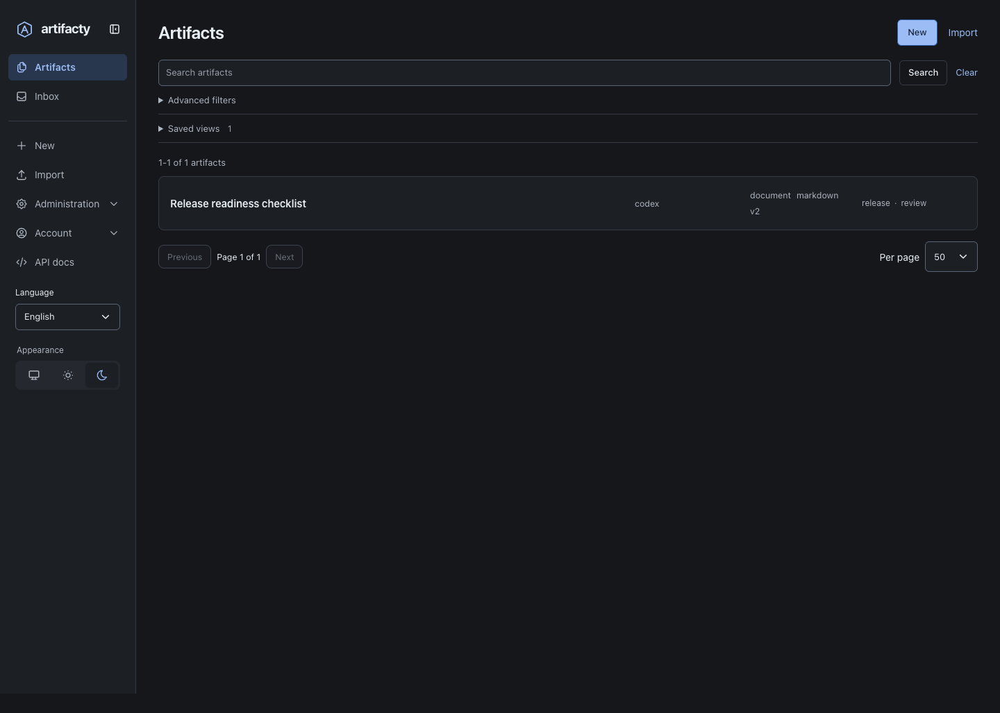

테마 선택에서는 라이트, 다크 또는 시스템 모드를 선택합니다. 선택한 값은 해당 브라우저에 저장됩니다. 사이드바를 접으면 콘텐츠를 볼 공간을 넓힐 수 있습니다.

### 가져오기

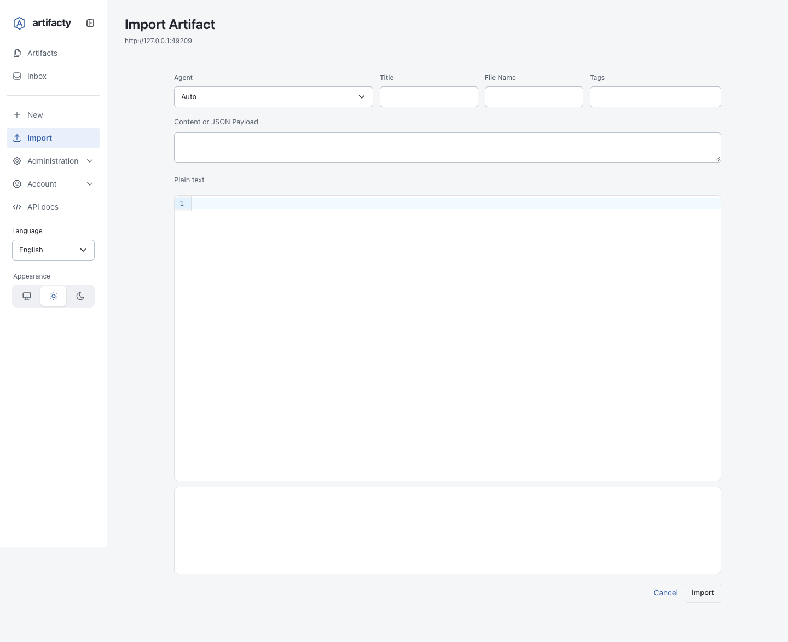

사이드바의 **Import**를 열고 에이전트 형식을 선택하거나 자동 감지를 사용하세요. 콘텐츠를 붙여넣고 가져오기를 실행한 뒤, 생성된 아티팩트의 제목·형식·내용을 확인하세요. 가져오기는 단순 미리보기가 아니라 저장소에 아티팩트를 생성하는 작업입니다.

### 접근 모드와 IP 제한

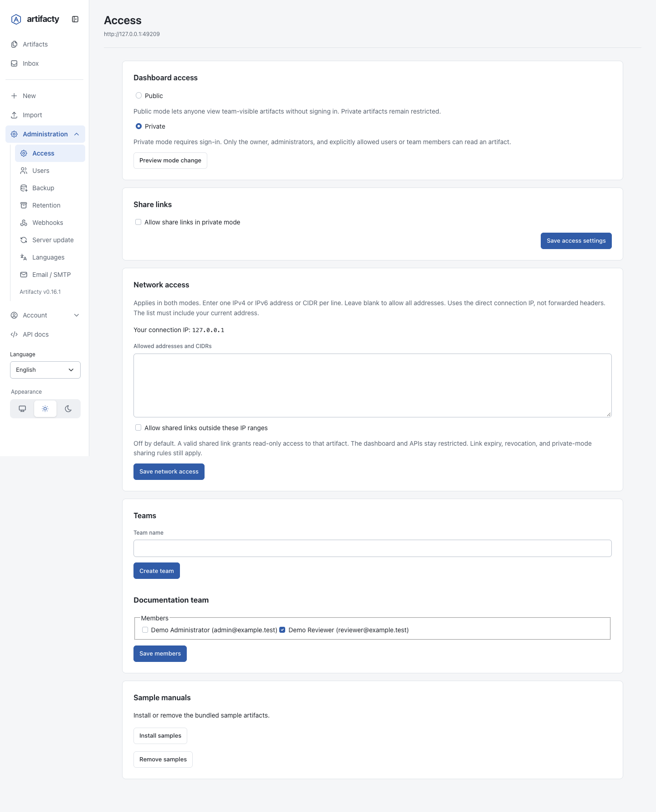

**Access**에서 공개·비공개 모드를 선택하고 **Preview mode change**로 익명 방문자가 볼 수 있는 범위를 확인하세요. 미리보기는 설정을 저장하지 않으며 특정 사용자나 팀의 접근을 재현하지 않습니다. IP 제한은 현재 접속 IP를 포함해 주소 또는 CIDR을 한 줄에 하나씩 입력합니다. **Save network access** 이후 표시되는 기한 안에 변경을 확인하지 않으면 이전 정책으로 복구됩니다. 저장한 정책과 실제 수신자의 접근 여부를 함께 확인하세요.

### 사용자와 역할

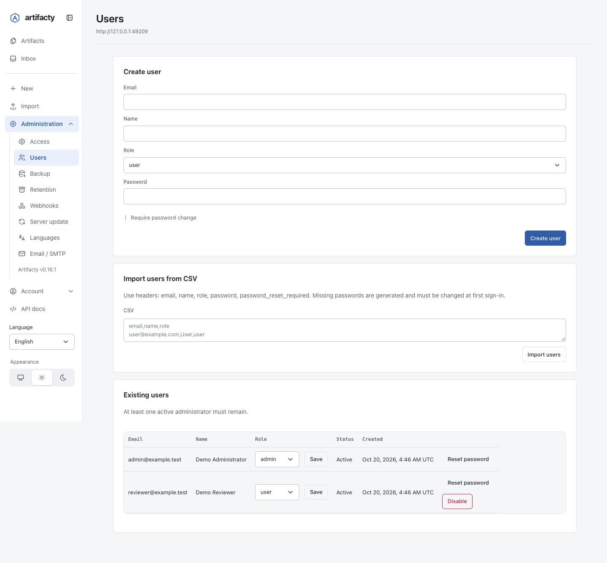

**Users**에서 사용자를 생성하거나 기존 사용자의 역할을 변경하세요. 역할 행의 **Save**를 누른 뒤 목록에 반영되었는지 확인합니다. 활성 관리자는 최소 한 명 남아 있어야 합니다. **Reset password**는 임시 비밀번호를 생성하고 기존 세션을 종료합니다. 임시 비밀번호는 한 번만 표시되므로 안전하게 전달하세요. 사용자는 로그인 후 비밀번호를 변경해야 합니다.

### 백업과 복구

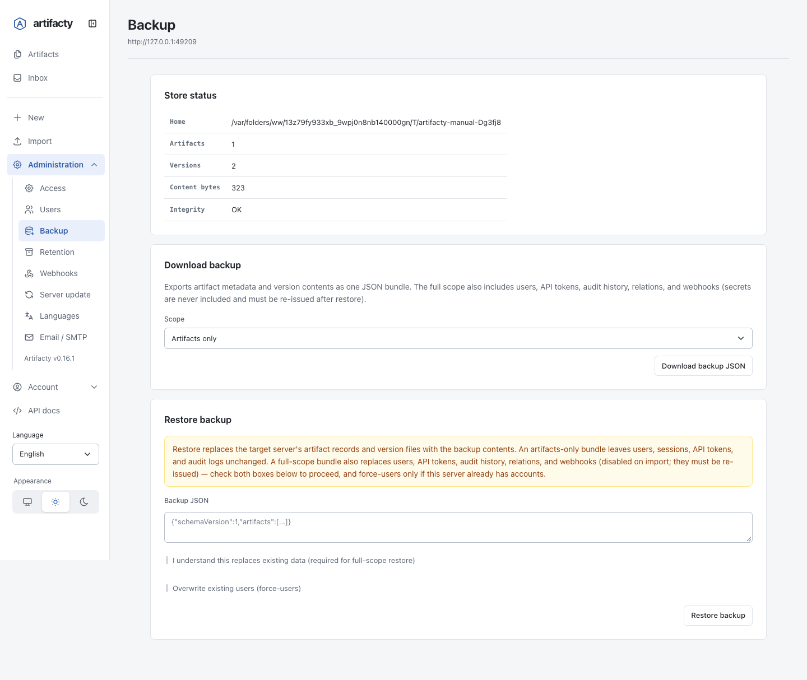

**Backup**에서 무결성 상태와 내보낼 범위를 확인한 뒤 **Download backup JSON**을 선택하세요. 파일 다운로드가 완료되었는지 확인합니다. 복구는 기존 데이터를 바꾸므로 화면의 범위별 안내와 확인 절차를 읽고 진행하세요. 운영 서버에서 복구를 시험하지 말고 격리된 저장소에서 백업을 검증하세요. 자세한 절차는 [업데이트 백업과 복구](upgrade-backups.md)를 참고하세요.

### 서버 업데이트

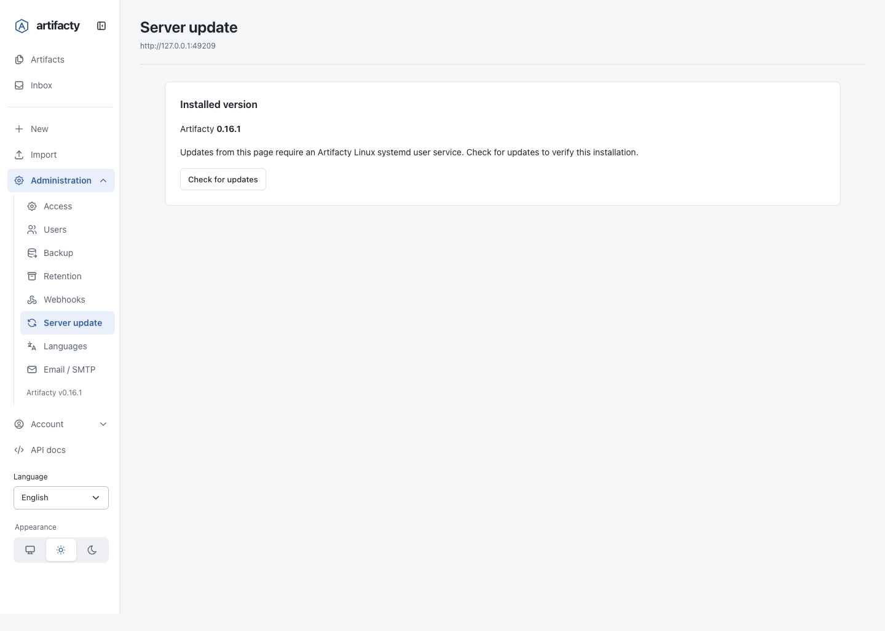

**Server update**에서 설치 버전을 확인하고 **Check for updates**를 선택하세요. 최신 버전이면 최신 상태 안내가 표시됩니다. 브라우저 업데이트는 지원되는 Linux systemd 사용자 서비스에서만 실행할 수 있습니다. 업데이트가 가능할 때 백업과 서버 재시작에 동의한 후 실행합니다. 완료 후 페이지를 새로 고쳐 설치 버전과 서버 응답을 확인하세요. 이 매뉴얼의 스크린샷은 업데이트를 실제 적용했다는 뜻이 아닙니다.

### 보존 정책

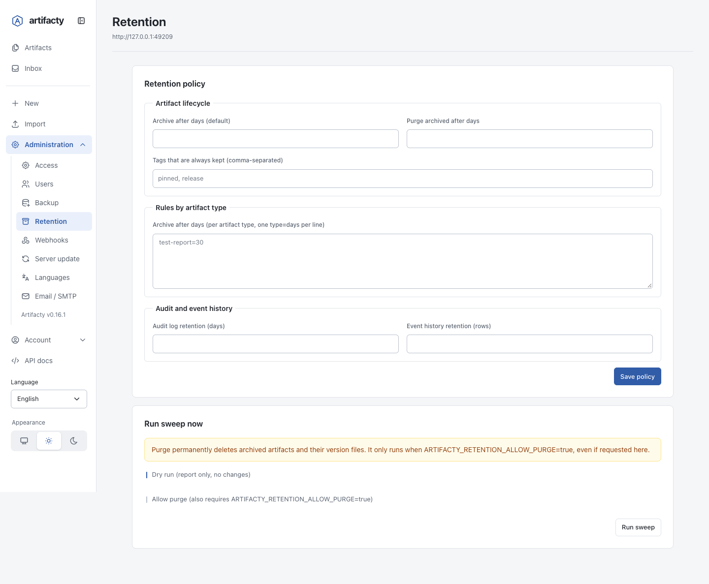

**Retention**에서 보관 기간과 예외 태그를 설정하고 **Save policy**로 저장하세요. 먼저 **Dry run (report only, no changes)**을 선택해 **Run sweep**을 실행하고 대상 목록을 확인합니다. 영구 삭제에는 화면의 허용 선택과 서버의 `ARTIFACTY_RETENTION_ALLOW_PURGE=true` 설정이 모두 필요합니다. 실제 정리를 실행했다면 결과 보고서의 보관·삭제 건수를 확인하세요.

### 화면 언어

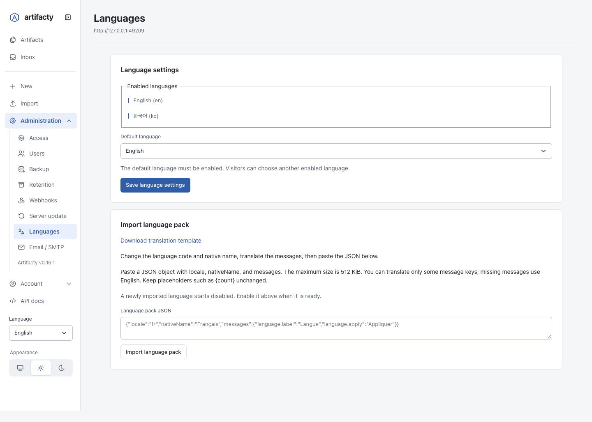

**Languages**에서 사용할 언어와 기본 언어를 선택한 뒤 **Save language settings**로 저장하세요. 새 언어 팩은 가져온 직후 비활성 상태이므로 검토 후 활성화합니다. 사이드바의 언어 목록과 기본 언어가 예상대로 표시되는지 확인하세요. [언어 팩](language-packs.md)에서 형식과 대체 언어 규칙을 확인할 수 있습니다.

### 비밀번호 재설정 이메일

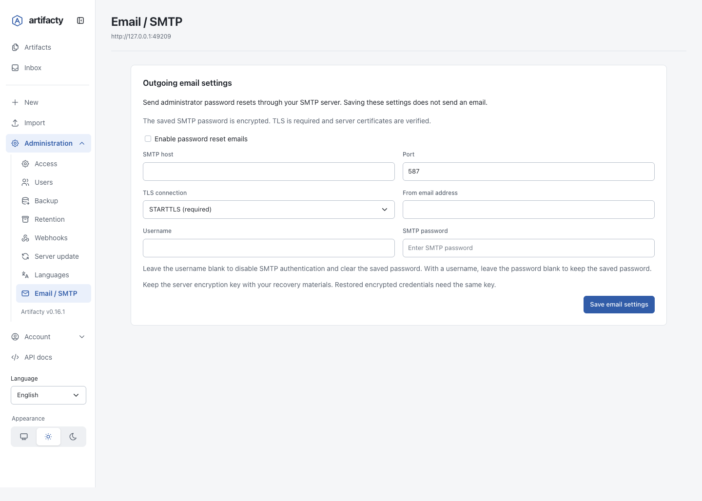

**Email / SMTP**에서 **Enable password reset emails**를 선택한 뒤 호스트, 포트, TLS 방식과 발신 주소를 입력하고 **Save email settings**로 저장하세요. 저장만으로 이메일을 보내지는 않습니다. SMTP 비밀번호는 암호화해 저장하며 TLS와 인증서 검증을 사용합니다. 실제 재설정 이메일은 수신자에게 전달되었는지 별도로 확인해야 합니다. SMTP 서버가 메일을 수락했다는 결과만으로 받은편지함 도착을 확인할 수는 없습니다. [SMTP 안내](smtp.md)를 참고하세요.

### 계정과 API 토큰

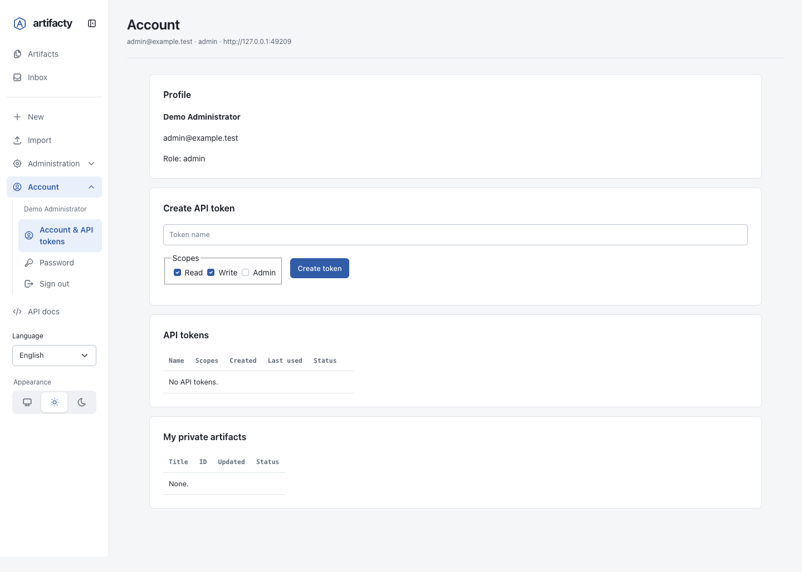

**Account & API tokens**에서 토큰 이름과 필요한 권한 범위를 선택해 토큰을 생성하세요. 토큰은 생성 직후에만 전체 값이 표시됩니다. 안전하게 보관하고 목록에서 이름과 범위를 확인하세요. 필요하지 않은 토큰은 폐기합니다. 토큰을 스크린샷이나 공개 문서에 넣지 마세요.

### 알림

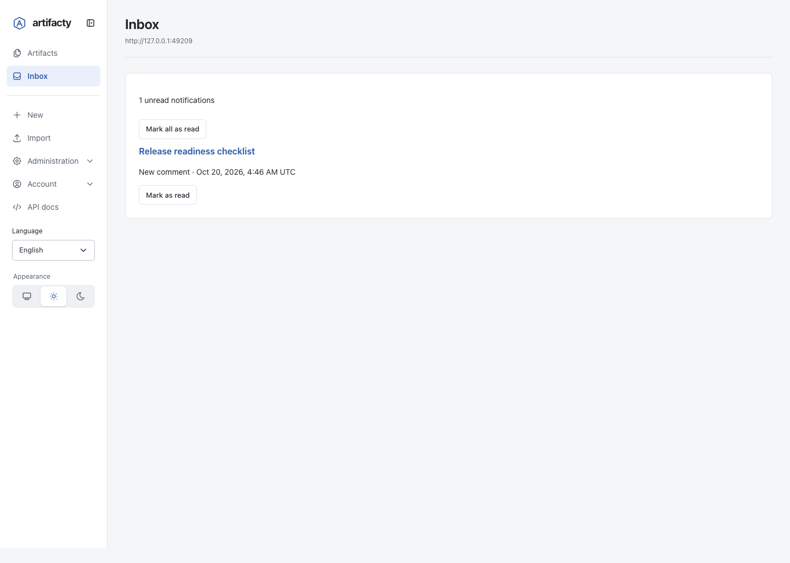

**Inbox**에서 공유, 댓글, 새 버전 또는 검토 요청 알림을 확인하세요. 아티팩트 제목으로 이동해 내용을 확인한 뒤 **Mark as read**를 선택합니다. 여러 알림을 한꺼번에 처리하려면 **Mark all as read**를 사용하세요. 읽지 않은 알림 수가 줄었는지 확인합니다.

### 웹훅

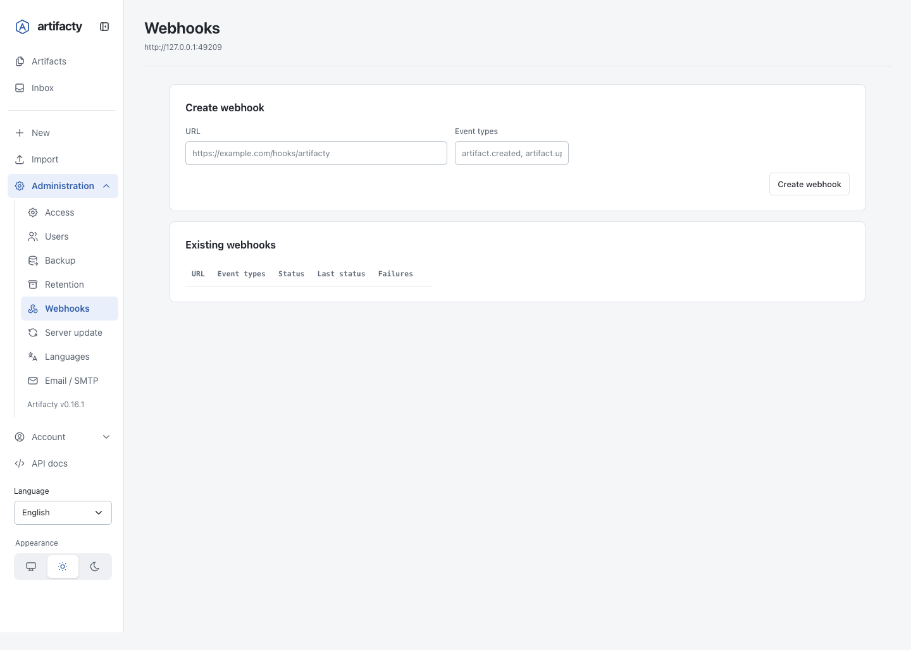

**Webhooks**에서 수신 URL과 이벤트 종류를 지정하고 **Create webhook**을 선택하세요. 생성된 서명 비밀값을 수신 시스템에 안전하게 설정합니다. 목록의 활성 상태와 전송 결과를 확인하고, 수신 시스템에서도 서명 검증과 이벤트 수신 여부를 확인하세요. 설정 화면만으로 외부 시스템에 이벤트가 전달되었다고 판단하면 안 됩니다.

### API 문서

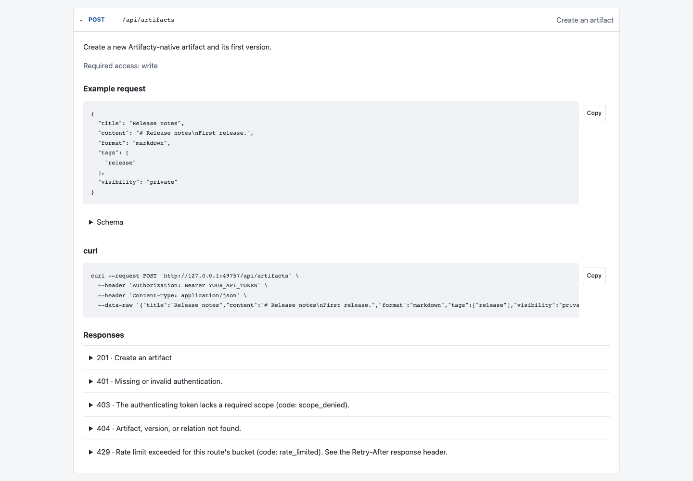

사이드바의 **API docs**를 열어 엔드포인트, 인증 조건과 요청 예제를 확인하세요. 대상 서버와 권한을 확인한 뒤 테스트 저장소에서 예제를 실행하고 응답 상태와 내용을 비교합니다. API 문서의 테마는 대시보드에서 선택한 테마를 따릅니다.

## 작업 결과 확인

변경한 뒤에는 해당 화면에서 결과를 확인하세요. 편집 후에는 버전 번호를, 검색 후에는 적용된 필터를, 공유 후에는 수신자의 접근 여부를 확인합니다. 접근 정책을 바꿀 때는 관리자 화면의 확인 절차와 자동 복구 안내를 따르세요. 삭제나 복구 같은 유지 관리 작업은 일상적인 열람과 구분해 진행하세요.

문서를 작성하거나 수정할 때는 [문서 작성·검증 기준](writing-style.md)을 따르세요. 스크린샷은 화면을 설명하는 자료이며, 권한 확인이나 실행 검증을 대신하지 않습니다.
