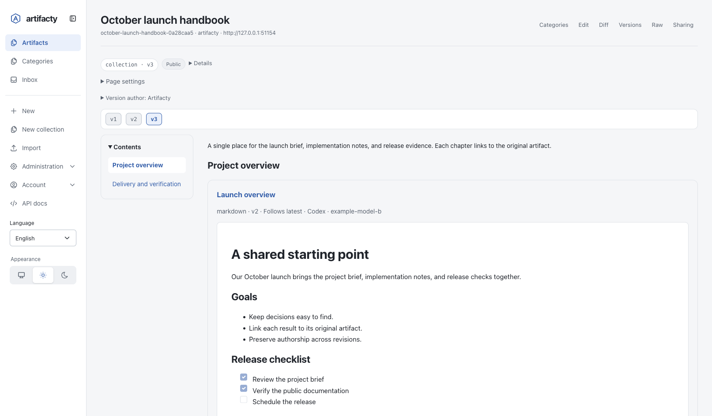
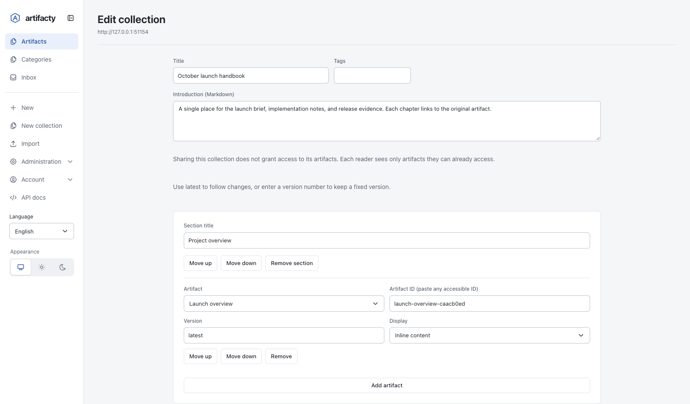
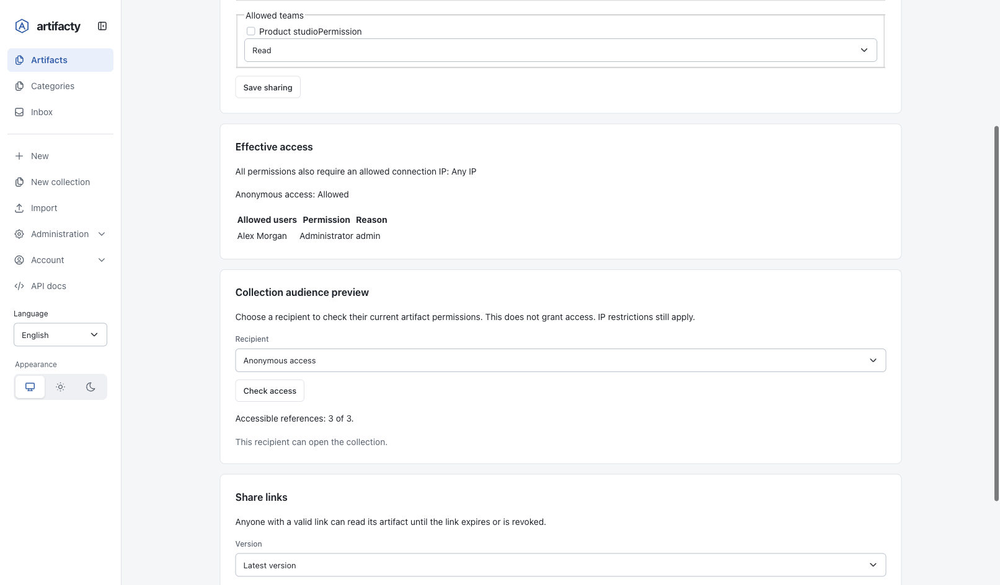
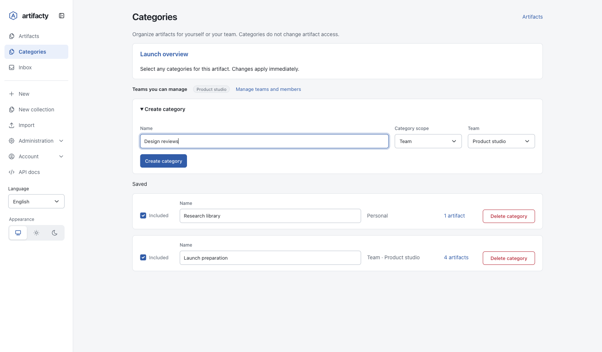
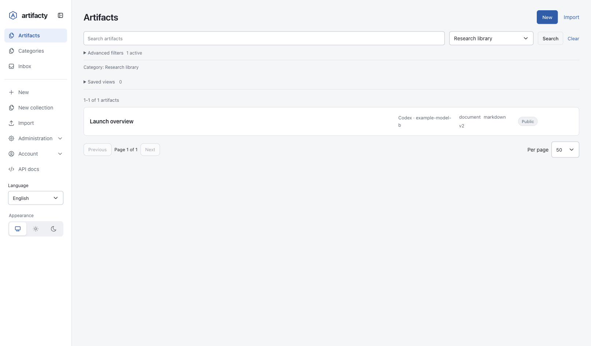
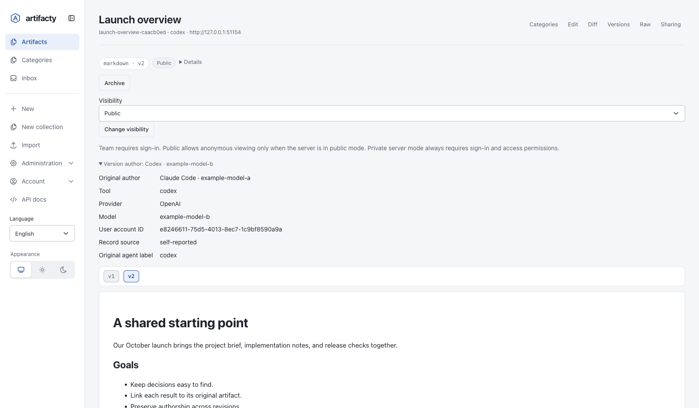

# Organizing artifacts and author history

English | [한국어](ko/organizing-artifacts.md)

These features are implemented for the next release. They are not included in published version 0.16.1. Use a build that includes these changes before following this guide.

The screenshots show English UI on an isolated public-mode server with fictional data and a signed-in administrator. The example model names are test labels, not claims about models used in production.

Collections and categories serve different purposes. A collection presents related artifacts as one page with sections and a table of contents. A category organizes your artifact list without changing the artifacts. Author history records the tool, model, and user responsible for each version.

## Build a collection page



The collection viewer keeps its contents navigation beside the referenced artifact. Each reader sees only the items they can access.

A collection references existing artifacts. It does not copy their content. The same artifact can appear in several collections.

1. Select **New collection** in the navigation.
2. Enter the title, tags, and visibility. Write an introduction in Markdown.
3. Select **Add section** and enter a section title.
4. Use **Add artifact** to select an artifact. If it is absent from the dropdown, paste its ID into **Artifact ID**; the server still checks access. Set its **Version** and **Display**.
5. Use **Move up**, **Move down**, or **Remove** to arrange sections and items.
6. Create the collection. Confirm that the viewer shows the expected introduction, sections, and **Contents** navigation.



The editor shows a latest-version reference displayed inline. The same controls can pin a version or use a link card.

Open an existing collection and select **Edit** to change its structure. Select **Save version** when ready. The editor does not auto-save unfinished content. Nested collections appear as cards rather than recursively expanding. Missing, archived, or inaccessible references do not display their content. When existing references are unavailable, the editor omits them and displays a warning. Restore access or the referenced artifact/version if you want to keep them. Alternatively, select **I understand that saving removes unavailable references from the new version** and save. This creates a new version without those references; earlier versions remain unchanged. Saving without this confirmation is rejected.

HTTP and MCP updates use the explicit boolean `dropUnavailableReferences: true` for the same recovery. Do not set it automatically when a read returns fewer items. Administrator repair has its own confirmation and changes the selected historical version under the existing repair rules; it is not an ordinary version append.

A collection supports up to 50 sections and 200 references. The introduction supports up to 50,000 characters, and each section title supports up to 200 characters.

Choose how each reference behaves:

| Setting | Behavior |
| --- | --- |
| Latest version | Shows the referenced artifact’s latest version when the collection is read. |
| Pinned version | Keeps a specific version number, suitable for release reports and manuals. |
| Inline | Displays the referenced artifact within the collection page. |
| Card | Displays a link to the referenced artifact. |

Pinning the collection’s own version does not freeze references set to **Latest**. Pin each referenced artifact when the complete page must remain reproducible. If a referenced version is removed through administrator maintenance, the collection does not silently substitute a different version.

Collection edits create new versions, like other artifact edits. Existing artifact sharing controls also apply to the collection.

### Collection permissions

Reading a collection does not grant access to the artifacts it references. Artifacty checks the reader’s permissions for each item and omits items the reader cannot access. It does not expose their titles, content, or identifiers through the filtered collection read. A collection can therefore contain different visible items for different readers.

A collection share link grants access only to the collection. It does not become a share link for every referenced artifact. Server mode, account permissions, and IP restrictions still apply. The exception for share links outside allowed IP ranges does not open the referenced artifacts.



In this example, the anonymous recipient can open the collection and all three references. This result applies to the test data and current permissions.

In **Sharing**, use **Collection audience preview**, select a **Recipient**, and select **Check access**. The preview reports the number of accessible references and whether the recipient can open the collection. It does not grant access.

Verify the collection using the intended recipient’s account. An owner or administrator can see more than the recipient. Do not place a private artifact’s title or sensitive information in the collection’s own description or section headings: those are collection content and follow the collection’s permissions.

## Use personal and team categories



The same artifact belongs to one personal category and one team category. The expanded creation form shows the existing team selector.

Sign in with an active account before using categories. Categories do not provide an anonymous or browser-local substitute for an account. Category management requires JavaScript.

1. Open **Categories** in the navigation.
2. Under **Create category**, enter a name and select **Personal** or **Team**. For a team category, select one of your available teams and create the category.
3. Open an artifact and follow its **Categories** link. Select **Included** for each category you want. Membership changes apply immediately; wait for **Saved**.
4. Return to **Artifacts** and use the **Category** filter, or follow a category’s artifact-count link, to view its members.
5. To rename a category, edit its name and leave the input. Wait for **Saved**. To delete a category, use **Delete category** and confirm; the artifacts remain.



Selecting the category narrows the list to its readable members without changing their tags or access.

Categories reuse existing teams. The page shows the teams available to you. Administrators can follow **Manage teams and members** to Access settings; other users ask an administrator to change membership.

- A personal category belongs to its owner. Other users, including administrators, cannot use it through the category interface.
- A team category is available to current members of that team and administrators. Any current member or administrator can manage it.
- One artifact can belong to several categories. Adding it does not change its tags, content, owner, or sharing permissions.
- Team members still need access to each artifact. Membership counts and filtered results exclude artifacts the reader cannot access. Archived artifacts are excluded unless the view includes them.
- Removing an item from a category keeps the artifact. Deleting a category removes its memberships, not the artifacts.

Names contain 1–120 characters after trimming. Names must be unique within one personal owner or team. Duplicate checks ignore ASCII letter case; they do not perform Unicode case folding. Each personal or team scope supports up to 200 categories. A category’s scope cannot change after creation; create a separate category when you need a different audience.

A saved view stores a set of search filters. A category stores explicit artifact memberships. Use a category for a hand-picked working set, and a saved view for results that should follow filter conditions.

## Read author history



The selected v2 records Codex while the original author remains Claude Code. Both model names are fictional fixture labels.

Open an artifact and expand **Version author**. Check **Original author** and the selected version’s tool, provider, model, account ID, and source. Select an earlier version to inspect its own author record.

Artifacty separates authoring details instead of treating every name as a source agent:

| Field | Meaning |
| --- | --- |
| `tool` | Authoring client, such as `claude-code`, `codex`, or `cursor`. |
| `provider` | Model provider, when supplied. |
| `model` | Actual model identifier supplied by the client. |
| `userId` | User identity derived from the authenticated request or trusted local audit context. |
| `rawSourceAgent` | Original source label retained for interpretation. |
| `source` | Overall provenance source: `legacy`, `mcp-client`, `self-reported`, or `unknown`. |
| `toolSource` | How the tool was identified. |
| `modelSource` | `self-reported` or `unknown`. |

`artifact.createdBy` preserves the initial author. `artifact.provenance` describes the latest version, and each entry in `artifact.versions` has its own `provenance`. When inspecting an older version, use that version’s provenance rather than the artifact-level latest value.

Exact tool aliases are normalized: **Claude Code** becomes `claude-code`, **Gemini CLI** becomes `gemini-cli`, and **codex-cli** becomes `codex`. **Claude**, **GPT**, **OpenAI**, **Anthropic**, **Google**, and **Gemini** alone do not identify a specific authoring tool. Missing provider or model information remains `null`; Artifacty does not guess the model from the client name.

A stdio MCP connection can provide its client name during `initialize`. This is a client declaration, not verified proof of the software’s identity. Model fields supplied by the client are also self-reported. HTTP MCP is stateless and does not retain an earlier `initialize` client name for later requests. Provenance is useful for tracing work, but is not a model attestation system.

Legacy records are marked as legacy. Earlier Artifacty releases combined some labels, including Claude Code into Claude. The migration cannot reconstruct information that those releases already discarded.

## Create a collection through MCP

First obtain the IDs of artifacts that the caller can read. Replace `report-artifact-id` below with a real ID from `artifacty_list` or `artifacty_create`.

Call `artifacty_collection_create` with:

```json
{
  "title": "Release review",
  "description": "Evidence and decisions for the release.",
  "sections": [
    {
      "id": "evidence",
      "title": "Evidence",
      "items": [
        {
          "artifactId": "report-artifact-id",
          "version": 1,
          "display": "inline"
        }
      ]
    }
  ],
  "provenance": {
    "tool": "codex",
    "provider": "openai",
    "model": "actual-model-id"
  }
}
```

Use the model identifier from the actual execution context. Omit it if it is unknown; do not send the placeholder `actual-model-id` as a real model name.

Read the result with `artifacty_get`. To edit it, call `artifacty_collection_update` with the returned `id`, the `expectedVersion` you last read, and the updated description and complete section list. A stale expected version produces a conflict instead of overwriting another edit. If references became unavailable, restore access or deliberately use `dropUnavailableReferences: true` after reviewing the omission. Use `version: "latest"` for a reference that follows new versions.

The native artifact format and type are both `collection`. Its content is the JSON object containing `description` and `sections`; title and provenance remain artifact fields. The ordinary artifact APIs continue to handle history, access, and sharing. See the [MCP reference](mcp-public-api.md) and [artifact schema](artifact-schema-v1.md).

## HTTP and CLI attribution

The HTTP create and update bodies accept the same `provenance: { tool, provider, model }` object. Do not place it inside `metadata`; free-form metadata is not the authoritative author record.

For CLI publish, import, and update, use `--tool`, `--provider`, and `--model`:

```sh
artifacty publish --title "Review notes" --content "# Review notes" --format markdown --tool codex --provider openai
```

This example intentionally omits a model because it does not know the running model ID. Add `--model` only when you know the actual value.

Category HTTP endpoints are `GET`/`POST /api/categories`, `PATCH`/`DELETE /api/categories/{id}`, and `PUT`/`DELETE /api/categories/{id}/artifacts/{artifactId}`. `GET /api/category-teams` lists teams available for category creation. Create a personal category with `{ "name": "My references", "scope": "personal" }`; a team category also needs `"scope": "team"` and the selected `teamId`. The artifact list accepts `categoryId`, including the `artifacty_list` MCP tool. API token scopes and current user permissions both apply.

## Store migration

This build uses store schema 11; the public artifact record remains schema version 1. Opening an older store requires the normal verified upgrade snapshot before migration. Older binaries refuse the newer store. Full-store JSON backups include categories and their memberships. Preserve the snapshot before switching builds, and use the [recovery procedure](upgrade-backups.md) if you need to return to the old build. Reinstalling sample manuals does not replace edits or existing installed manual versions.

## Check your result

1. Open the collection and follow its table of contents. Check that the section order and displayed items match your editor.
2. Update a referenced artifact in a disposable store. Confirm that a latest reference changes while a pinned reference stays on its selected version.
3. Open the collection as the intended recipient. Confirm that restricted items are absent and that sharing the collection did not grant additional access.
4. Select a category and check that only its readable members appear. Remove a membership and confirm that the artifact still exists in the main list.
5. Create and update an artifact with different tool declarations. Confirm that the initial author remains unchanged and that the new version has its own author record.
