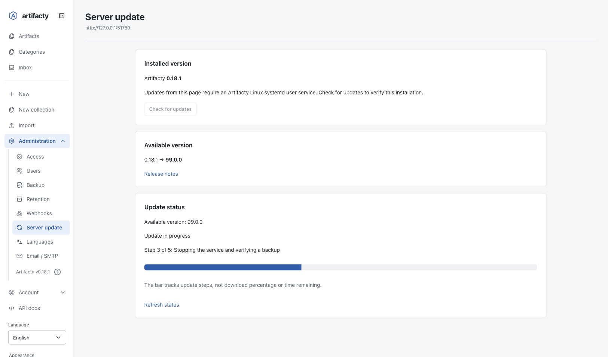
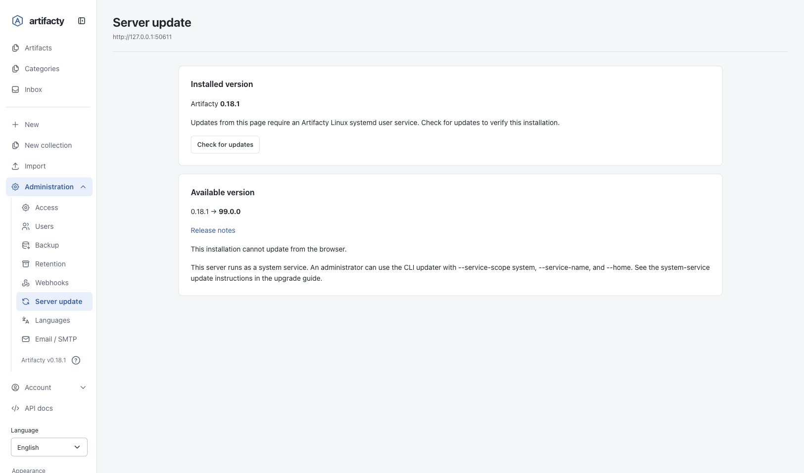

# Upgrade Snapshots and Recovery

English | [한국어](ko/upgrade-backups.md)

Artifacty creates a local snapshot before it migrates an existing store to a newer schema. This snapshot is mandatory. If snapshot creation or verification fails, Artifacty stops before migration.

Use upgrade snapshots to recover the original store state. Use `artifacty backup` and `artifacty export` for portable JSON backups and store transfers. These are separate backup systems. `artifacty restore <id>` restores an archived artifact; it does not restore a store snapshot.

## Application Self-Update

The application updater and schema migration snapshots serve different purposes. `artifacty update` without an artifact ID updates the application. `artifacty upgrade` is an alias. `artifacty update <id>` continues to update an artifact.

### Check and select a release

Replace `<version>`, `<id>`, and `/path/to/store` with the exact release, snapshot ID, and store path before running these examples.

```bash
artifacty update --check
artifacty upgrade --check --target-version "<version>" --home /path/to/store
```

`--check` reports the release without changing the installation, service, or store. You can also run this check on other CLI platforms. It reports whether automatic installation is supported. The release check requires network access. For the managed service, the updater compares the package version used by that service, not just the invoking CLI version. `--target-version` accepts an exact version. Without that option, the updater selects the latest release. `--home` selects the store to protect. Automatic downgrades are not supported. An explicitly selected older version is rejected; an older `latest` release leaves the newer installation unchanged.

For installed versions before 0.14.0, bootstrap the updater with:

```bash
npx --yes artifacty@latest update --home /path/to/store && export PATH="$HOME/.local/bin:$PATH"
```

The command uses POSIX Linux shell syntax. After a successful update, it puts `~/.local/bin` first on `PATH` for the current session. For future sessions, add that directory to your shell's `PATH`.

The `latest` tag must resolve to version 0.14.0 or newer to include the updater.

### Update from the browser

Sign in with an administrator browser session. Open **Administration → Server update** (`/admin/update`). API tokens do not replace that session for these routes.

1. Select **Check for updates**. This checks the latest npm release without installing or restarting the service.
2. If browser updates are supported and a newer version is available, review the displayed target version.
3. Select the confirmation checkbox for backup and restart.
4. Select **Back up and update**.
5. Keep the page open while the server restarts. Read the update result after reconnection.

The progress bar reports update stages, such as preparing the release, verifying the snapshot, restarting the service, and checking health. It is not a byte-based download percentage or a time estimate. When progress cannot be determined, the bar remains indeterminate. A failed update, an interrupted worker, or incomplete recovery is not shown as success; read the result before reconnecting clients.



Administrator view during the backup stage with a fictional target version, `99.0.0`. This UI example shows step progress, not a completed host update. After a successful update, the result appears when the page reconnects. Once a new page load confirms that the installed version matches the target, the completed progress panel is hidden and the page reports that the server is up to date. The stored job history is retained.

The update confirmation expires after ten minutes. Only the browser session that checked the version can use it. If it expires or the installed version changes, check again. Form submissions require the exact same origin as the server. No password re-entry is required.

Browser installation requires this server to be the non-root Linux systemd user service. Other installations can check the latest release, but cannot start the update from this page. The worker runs in an independent systemd transient service, so stopping the Artifacty server does not stop the update worker. Status is stored outside the artifact store under `~/.local/share/artifacty/update-jobs`.

Opening the page or reading status does not contact npm or install a package. Status checks can inspect systemd to identify a stopped worker. If Artifacty cannot determine whether the worker started, it keeps the job reserved. If the worker stops unexpectedly or recovery is incomplete, inspect the job manually before another update. Artifacty does not report these states as success. Keep the retained snapshot and releases until recovery is verified.

### Automatic installation limits

By default, automatic installation and restart use the Linux systemd user service `com.artifacty.server`. Run the updater as the service's user. The unit must use the simple `ExecStart` form produced by Artifacty's installer and must explicitly pass `--home` for the selected store. Unsupported command expansion or quoting stops the update before service shutdown. User-service updates reject root execution. Do not run that mode as root to replace a root-owned global package.

The updater stages packages under `~/.local/share/artifacty/releases`. It changes the managed service's executable through a systemd drop-in and preserves its existing arguments and environment. User-owned launchers go under `~/.local/bin`. If that directory is not on `PATH`, add it before using those launchers. Existing unmanaged files in that directory are not overwritten. The existing root-owned global package remains unchanged. If `PATH` selects another command first, the result supplies an absolute `nextCommand`. The updater does not edit shell configuration.

Automatic switching does not support macOS, Windows, foreground servers, detached background servers, or service units that fail the updater’s configuration checks. Use the manual installation and snapshot procedures for those environments.

### System-service updates

System-service updates require Artifacty 0.19.0 or later. Artifacty 0.18.1 and earlier do not recognize these options. Before updating an older server, prepare an administrator-verified installation of 0.19.0 or later and use its CLI for the commands below.

A system service does not need a user login session or a `systemctl --user` bus. An administrator can select the system service explicitly. The server must continue to run as a dedicated non-root service account; root privileges are for the update command, not the HTTP server. The update command installs the release as root with root's npm configuration and with lifecycle scripts disabled, so the service account cannot change the registry or the staged files. Configure any private registry for root, because the updater ignores `.npmrc` files in the service account's store.

Replace the example CLI path with an absolute, trusted installation path and `/path/to/store` with the service’s store. Check first:

```bash
sudo /usr/bin/node /path/to/trusted/artifacty/src/cli.js update --check --service-scope system --service-name artifacty.service --home /path/to/store
```

Review `currentVersion`, `targetVersion`, `supported`, and any `reason` in the result. If the configuration is supported, run the same command without `--check`:

```bash
sudo /usr/bin/node /path/to/trusted/artifacty/src/cli.js update --service-scope system --service-name artifacty.service --home /path/to/store
```

System scope defaults to `artifacty.service`; use `--service-name` for another unit. `ARTIFACTY_SERVICE_SCOPE` and `ARTIFACTY_SERVICE_NAME` provide the same defaults, but explicit flags avoid environment filtering by `sudo`. A read-only check can run without root when the account can inspect the system manager. Applying an update requires root.

The unit must name a fixed, non-root `User`, use an absolute Node executable and server path in a simple `ExecStart`, and explicitly pass the selected `--home`. Root services, `DynamicUser`, and unsupported command expansion are rejected. The updater prepares releases under `/var/lib/artifacty-updater/<unit>/releases/` and switches `ExecStart` with `/etc/systemd/system/<unit>.d/zz-artifacty-self-update.conf`. Existing `User`, environment files, and other service settings remain in place. Installation and package checks, snapshot creation, and recovery run as the service account. After stopping the service, the updater requires that no other processes remain under that dedicated account, then makes the prepared release root-owned before switching. A shared account with remaining processes is rejected and the previous service is restarted. The existing application directory is not replaced in place, and no system-wide launcher is changed. Use the absolute `nextCommand` returned after success for later updates.

Use `--target-version "<version>"` to select an exact release. Do not run a service-account-writable copy of the updater with root privileges. The update command validates the service before changing it and uses the same staging, verified snapshot, health-check, and rollback protections described below.

System-service installation cannot start from the browser. The administrator must run the privileged CLI command on the host. The administrator page identifies this installation mode and shows the host command.



Administrator view with a fictional target version, `99.0.0`, showing the system-service CLI guidance. This is a UI demonstration; it does not show a completed host update.

Do not grant the web server unrestricted `sudo`, `systemctl`, or package-installation permissions to bypass this limit. PostgreSQL automatic updates remain unsupported; verify the database backup and artifact files together and follow the [PostgreSQL update procedure](postgresql.md).

### Store protection and rollback

Before updating, stop other HTTP servers and local MCP clients that use the same store. The updater manages the supported systemd service itself. It cannot identify every other process with an open store. The service is unavailable during the update. A store rollback discards writes made after the snapshot; do not keep other writers active during this procedure.

For an active service, the updater checks current health before shutdown. If its bind address or IP policy prevents that check, it refuses the update before downtime. Unsupported service configurations also fail before shutdown.

The updater installs the exact target package in its staging directory and verifies it. It then stops the managed service, creates a snapshot, and verifies the snapshot before switching code. If the service was active, it restarts the service and checks its health and PID. An inactive service remains inactive. It preserves the previous code and service configuration for rollback. If switching or startup fails, it attempts to restore the changed code, service configuration, and store, then restart the previous service. If service stop fails, it does not restore a store while the service may still be writing to it. The restored store includes the credentials and security state from the snapshot. Review any recovery error before allowing clients to reconnect.

An abrupt process or host termination during the switch can leave `update.lock` or a stopped service. The next update reports the lock instead of retrying blindly. Preserve snapshots, staged releases, and recovery files. Inspect the service and recovery state before a manual retry. Automatic rollback handles caught failures; it does not guarantee recovery from power loss or forced process termination.

Keep the snapshot and the update result until the restarted service works. If automatic rollback cannot finish, the updater reports an explicit error and preserves the `backupId`. Use that snapshot with the recovery procedures below. Do not delete recovery files or force an older build to open an unsupported schema.

## When Artifacty Creates a Snapshot

- **Schema migration:** Artifacty always snapshots an existing store before migration. This includes a legacy `index.json` store. A new empty store needs no snapshot.
- **Application update:** Set `ARTIFACTY_BACKUP_ON_UPDATE=true` to also snapshot an existing store when the application version changes. This setting is off by default.
- **Unknown application version:** With the update setting enabled, the first open of an existing store without an application-version marker creates a baseline snapshot. Its source application version is unknown. Later opens with the same version do not repeat it.
- **Restore:** Before replacing a store, Artifacty creates and verifies a recovery snapshot of its current state.

Stop every HTTP server and MCP process that uses the store before an upgrade or restore. This includes services, foreground servers, and local stdio MCP clients. Artifacty checks managed server PID markers, but these markers cannot identify every process with an open store.

Snapshots are stored at `ARTIFACTY_HOME/upgrade-backups/<id>/`. The default home is `~/.artifacty`.

## Snapshot Contents

Each snapshot contains a manifest with file sizes and SHA-256 hashes. It also contains:

- A consistent raw SQLite database, including all tables and security state.
- Every version file referenced by the database or an authoritative legacy index.
- The legacy `index.json`, if it exists.

Verification checks the file hashes, SQLite integrity, and version-file references. Snapshots do not include unrelated files, process markers, logs, or the complete installation directory. Keep snapshots private: they contain credentials and security records.

`ARTIFACTY_UPGRADE_BACKUP_KEEP` controls automatic snapshot retention. The default is `3`; valid values are integers from `1` through `1000`. Artifacty prunes older automatic schema/update snapshots after a successful upgrade. It does not prune manual or recovery snapshots with this setting.

## Inspect Snapshots

List snapshots without opening or migrating the store:

```bash
artifacty backups list --home /path/to/store
```

Copy an `id` from the output. Verify that snapshot:

```bash
artifacty backups verify "<id>" --home /path/to/store
```

A successful response includes `valid: true`. The list command checks manifests. It does not replace full snapshot verification. From a repository checkout, use `node src/cli.js` in place of `artifacty`.

## Restore a Snapshot

A restore replaces the current database, version files, and legacy index. Changes made after the snapshot are no longer current. Artifacty keeps the pre-restore state in a separate recovery snapshot.

**Security state also rolls back.** Old passwords, permissions, network rules, sessions, API tokens, and share-link records can become current again. A session, token, or link revoked after the snapshot can become valid again if it has not expired. Review the restored security state before allowing users to reconnect.

1. Stop all server, service, and MCP processes that use this store.
2. Select a snapshot from `backups list`.
3. Verify it with `backups verify`.
4. Restore it with explicit confirmation:

```bash
artifacty backups restore "<id>" --confirm restore-store --home /path/to/store
```

5. Save the returned `recoveryBackupId`.
6. Review the restored security settings before reconnecting clients.

Restore does not migrate the selected snapshot. Opening it with the current application can trigger another protected migration. A build that does not support the restored schema rejects the store.

## Recover When the Current Store Is Corrupt

If Artifacty cannot verify the current store for its recovery snapshot, it returns `RECOVERY_BACKUP_FAILED`. It does not overwrite the damaged store.

1. Keep the damaged home and its snapshots unchanged.
2. Create a new empty home directory.
3. Copy the selected snapshot directory into the new home's `upgrade-backups/` directory. Preserve its original snapshot ID and directory contents.
4. Run `backups verify <id> --home /path/to/new-home`.
5. Run `backups restore <id> --confirm restore-store --home /path/to/new-home`.
6. Review the restored data and security settings before using the new home.

Do not copy the damaged database over the new home. The selected snapshot supplies the database and referenced version files.

## Recover an Interrupted Restore

If a restore stops before it writes `restore.json`, it has not changed the store yet. Artifacty removes that `.restore-<uuid>` directory the next time it opens the store or takes a snapshot, because the directory only holds copies of a snapshot. If a `.restore-<uuid>` directory with `restore.json` remains, Artifacty stops with `RESTORE_INCOMPLETE`.

1. Preserve that directory and the entire affected home.
2. Read `.restore-<uuid>/restore.json`.
3. Find its `recoveryBackupId`. This identifies the snapshot of the state before the interrupted restore.
4. Copy that recovery snapshot into a new empty home's `upgrade-backups/` directory.
5. Verify and restore it there with the commands above.

Do not remove the interrupted restore directory to bypass the check. It contains recovery evidence and can contain the previous database and files.
