# Browser user guide

English | [한국어](ko/user-guide.md)

This guide covers everyday work in the Artifacty browser interface. Install and start the server using the [README](../README.md), then open the address printed by the server.

The screenshots use English UI labels and example data on a local, single-user server. A shared server can require sign-in and show different controls according to your permissions. Additional feature screenshots use a fictional administrator account on a separate private test server. Both guides use the same English screenshots. Settings screenshots do not prove that external email delivery or a server update was performed. Changing the interface language does not translate artifact content.

Jump to a task: [Find an artifact](#find-an-artifact) · [Create or edit an artifact](#create-or-edit-an-artifact) · [Preview content](#preview-content) · [Read versions and compare changes](#read-versions-and-compare-changes) · [Share and review](#share-and-review) · [Administration and preferences](#administration-and-preferences) · [Check your work](#check-your-work)

## Find an artifact

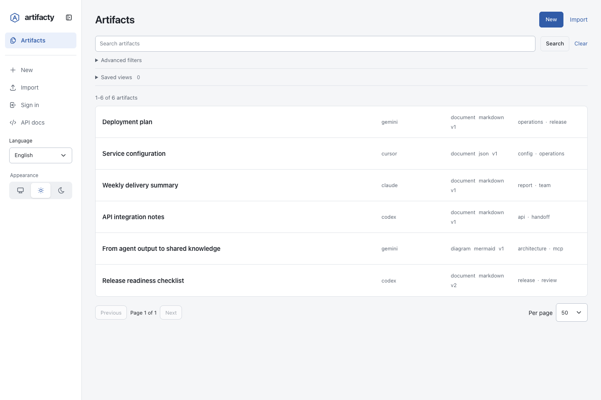

1. Open **Artifacts** in the sidebar.
2. Enter a term in **Search artifacts** and select **Search**.
3. Open **Advanced filters** to narrow results by tag, source, type, publisher, date, or review status. With JavaScript enabled, these filters apply when you change them. Use **Clear** to reset the filters.
4. Select an artifact title to open it.

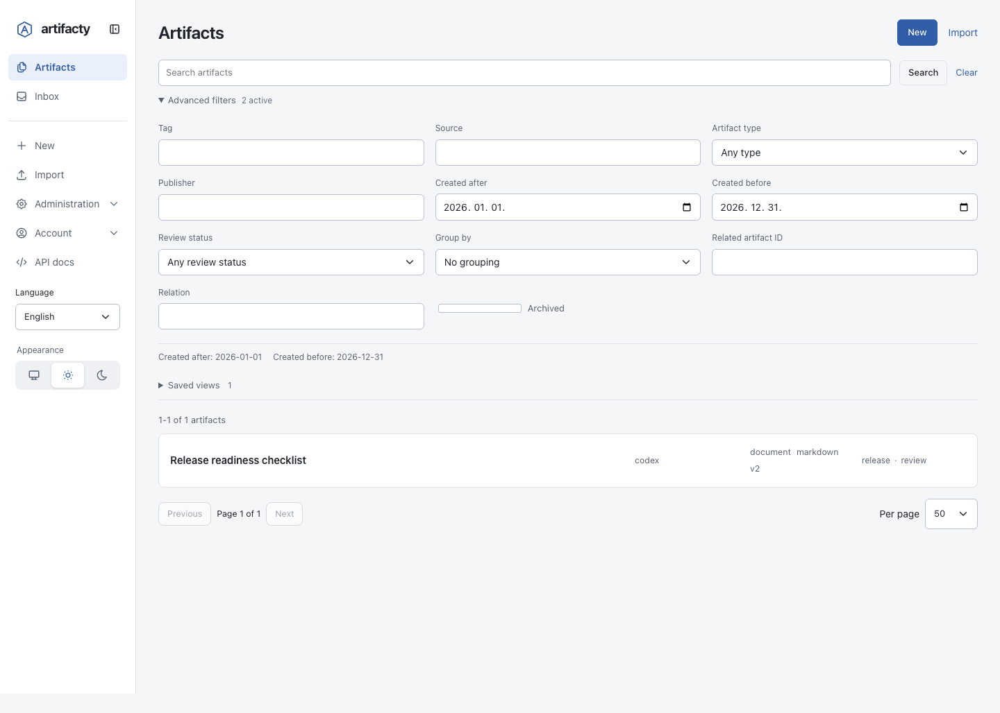

At the bottom of the list, use **Previous** and **Next** to change pages. **Per page** offers 10, 25, 50, or 100 items and applies immediately with JavaScript enabled. Check the result count to confirm that the filter or page change took effect.

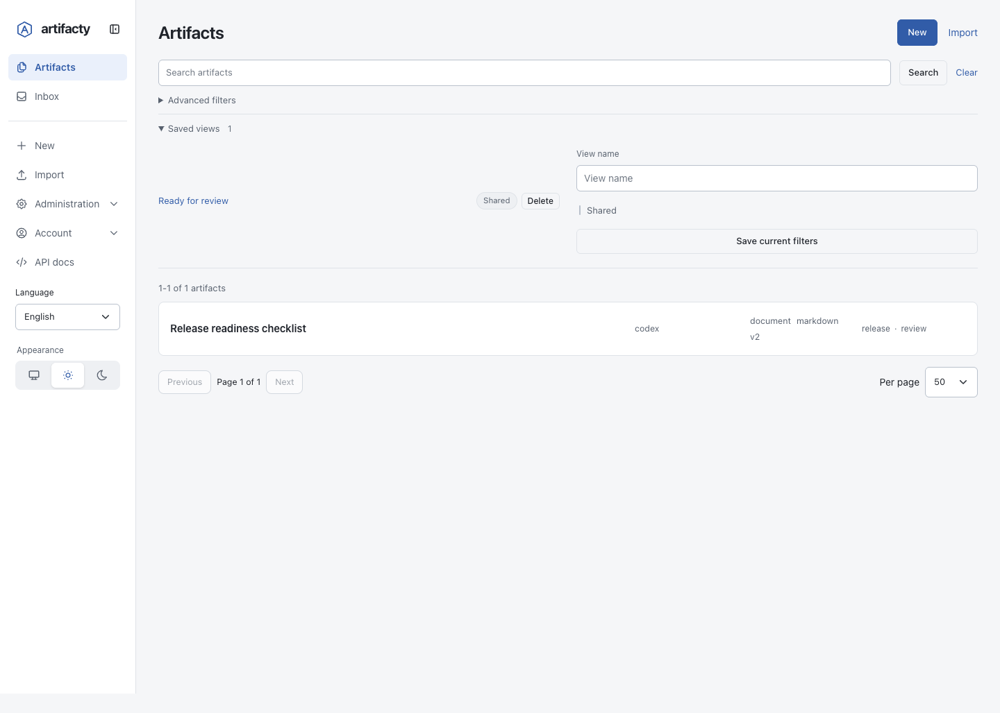

Use **Saved views** to name and save a set of filters for reuse. Saving a view is an explicit action; changing filters does not overwrite an existing view. A filter changes the displayed results, not the underlying artifacts.

The bundled local ONNX model adds semantic matching to the default hybrid search. For setup, model selection, indexing existing artifacts, and a search example screenshot, see [local models and semantic search](embeddings.md).

## Organize artifacts and inspect authors

Artifacty 0.17.0 adds collection pages, personal and team categories, and per-version author records. Follow [organizing artifacts and author history](organizing-artifacts.md) for the browser steps, screenshots, permission rules, and MCP examples.

## Explain existing content

Artifacty 0.17.0 also adds **Explain interactively** on the artifact viewer. Create a separate private explanation with guided steps, comparisons, connected elements, or authored scenarios. The source remains unchanged. See [interactive explanations](interactive-explainers.md) for screenshots, evidence labels, and sharing precautions.

## Create or edit an artifact

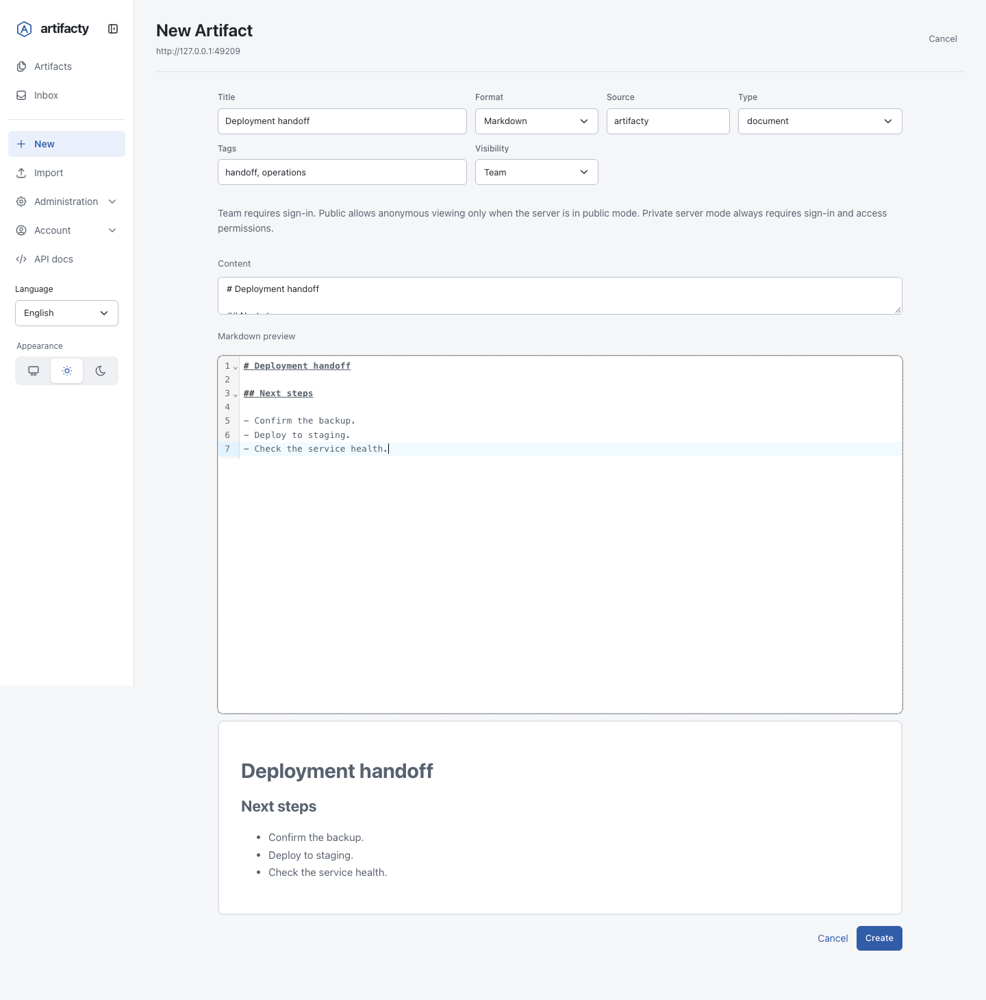

1. Select **New** on the artifact list.
2. Enter a title and choose the content format. Add source, type, and tags as needed.
3. Choose the visibility and enter the content.
4. Select **Create**. Confirm that the viewer opens with the expected title and content.

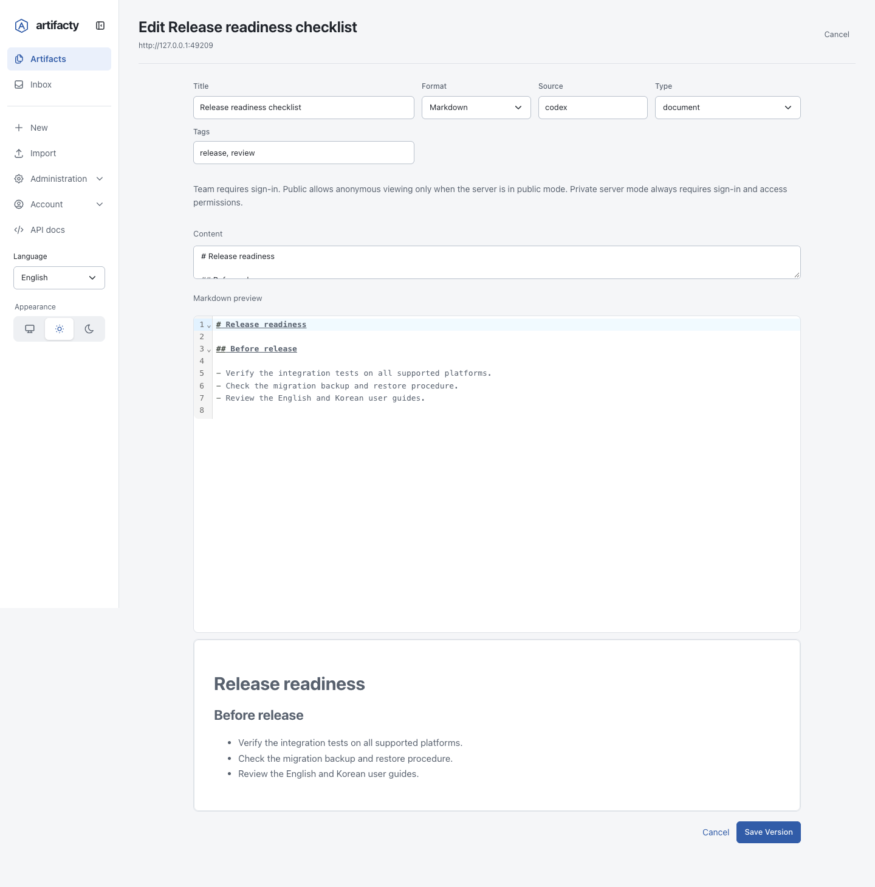

To change an existing artifact, open the version you want and select **Edit**. The editor loads that selected version. Saving creates a new version and preserves the original. Select **Save Version** when the content is ready. Editing is not auto-saved. Confirm that a new version number appears in the viewer. If another person saved a version while you were editing, inspect the conflict and its diff before submitting again.

Visibility and server access mode are separate controls. Public visibility does not bypass a private server's sign-in and sharing rules. Owners and administrators can change visibility from the artifact viewer. See the [README access reference](../README.md) for the complete permission rules.

## Preview content

Use **Zoom out**, **Zoom in**, **Fit**, and **100%** in a Mermaid preview to read large diagrams. Scroll inside the preview to reach content beyond its visible area.

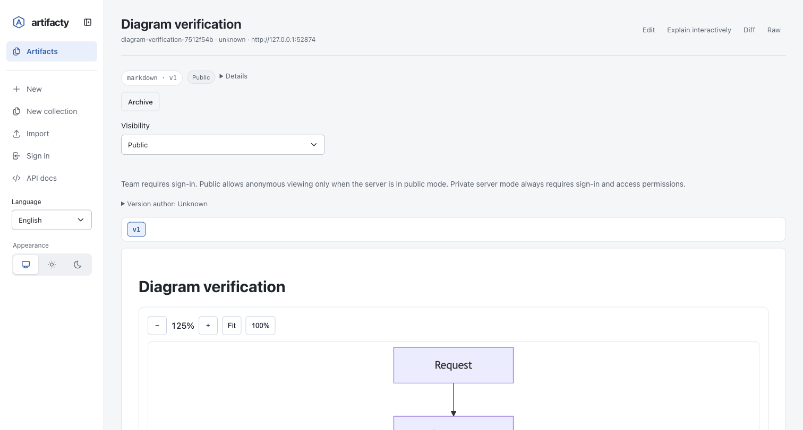

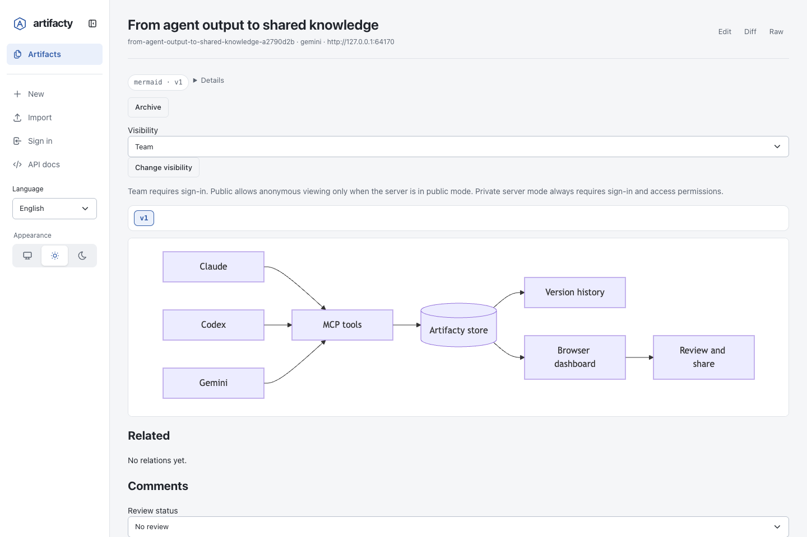

The viewer selects a preview based on the stored format. Markdown can contain fenced Mermaid diagrams. Other formats include HTML, SVG, code, JSON, CSV, SARIF, notebooks, and media. Preview capabilities depend on the format and server settings; use **Raw** to inspect the stored source.

HTML runs inside a sandboxed frame. Public share links have stricter previews: HTML scripts and external resources are disabled, while React, notebook, SVG, and Mermaid artifacts show source instead of active content. Do not assume that a public share link will behave exactly like the signed-in viewer.

## Read versions and compare changes

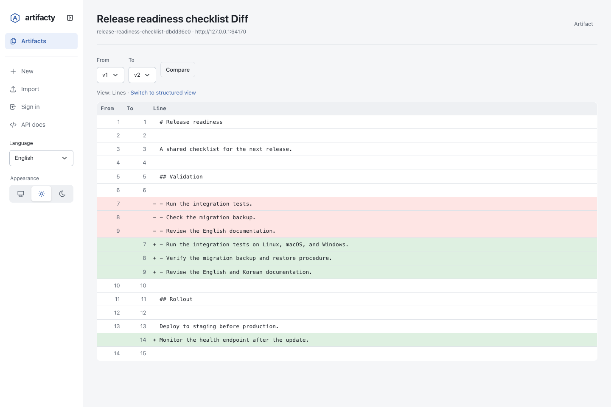

1. Open an artifact and select a version such as **v1** or **v2** in the version strip.
2. Confirm the displayed version number before reading or copying content.
3. Select **Diff**, choose **From** and **To**, then select **Compare**.
4. Inspect the changes. Where supported, switch between structured and line views.

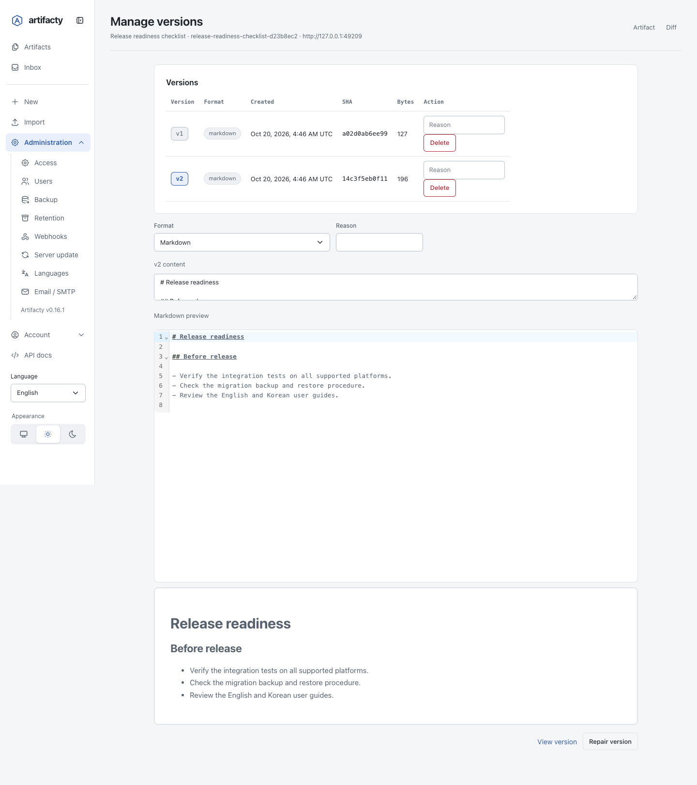

Opening an older version does not restore it or remove newer versions. **Versions** is a separate administrator control for version maintenance; it is not required to read earlier versions. For recovery and backups, see [upgrade snapshots and recovery](upgrade-backups.md).

## Share and review

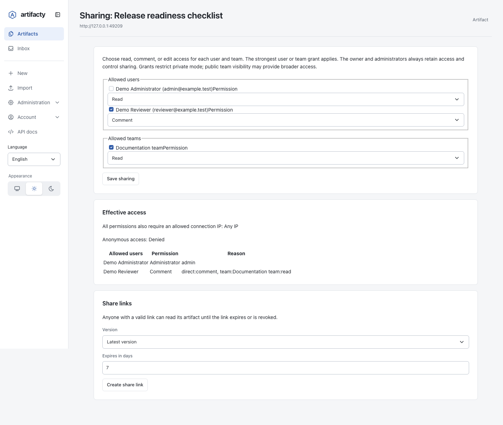

On a shared server, an artifact owner or administrator can open **Sharing**. Select users or teams, set their read, comment, or edit permission, and save the sharing settings. Verify access with the intended recipient's account; your own administrator account does not prove that recipient access works.

### Change visibility

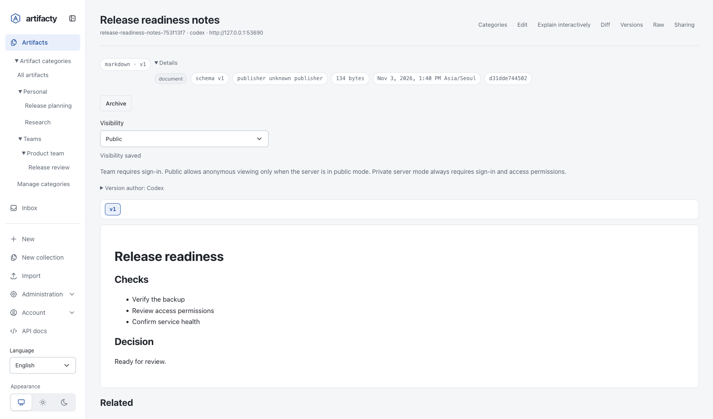

An administrator changed the fictional artifact to **Public** and received **Visibility saved** without a separate submit button. Server access mode still applies.

In the artifact viewer, an owner or administrator can change **Visibility**. With JavaScript enabled, selecting a value saves it without leaving the page; the separate **Change visibility** button is hidden. Wait for **Visibility saved** before treating the change as complete. If the result cannot be confirmed, the dropdown returns to its previous selection and displays an error. This does not prove that the server rejected the change: the server may have saved it before the response was lost. Reload to check the saved value before trying again. Unsaved comment text remains in the form during this operation. Without JavaScript, choose the value and submit **Change visibility**.

Visibility remains subject to the server’s access mode and sharing policy. Selecting **Public** does not bypass a private server’s login or permission requirements. Verify access with the intended recipient’s account.

A share link provides read-only access to the selected version or the latest version. Choose an expiry and create the link. Copy it immediately: the complete token is shown only when the link is created. Revoke a link when it is no longer needed. Private servers disable share links by default unless an administrator allows them.

IP restrictions still apply unless an administrator enables the specific shared-link exception. That exception permits valid share links and their raw content; it does not open the dashboard, API, or MCP to the blocked IP range. See [network sharing](network-sharing.md).

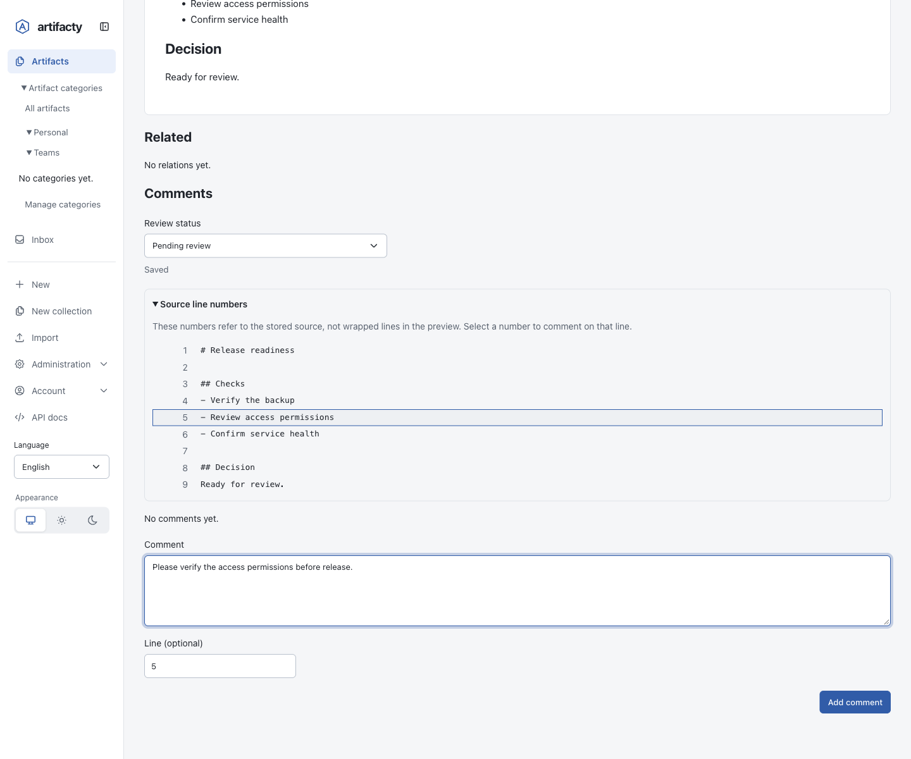

The following comment controls are available in Artifacty 0.19.0 and later. The screenshot uses a fictional artifact with administrator access.

Comments support discussion about an artifact version. Enter a message and select **Add comment** below the form. A line number is optional for `text`, `code`, and `markdown` artifacts. Open **Source line numbers** to inspect the exact stored source for the version you are viewing, then select its line-number button to fill the optional line field. The rendered document’s visual lines can wrap or omit source syntax, so they do not define these line numbers. Other formats do not show this source panel or line field, including images, video, notebooks, SARIF, CSV, collections, and interactive explainers. Existing API row and path anchors are unchanged.

The source panel shows at most the first 5,000 lines, and its line field accepts numbers from 1 to 5,000. For longer source, read the truncation notice and follow the **Raw** version link to inspect the complete stored content. The limit affects this panel, not the artifact or its raw content.

A comment’s line link opens its recorded artifact version and identifies the source row when that row is within the displayed range. If you are reading an older version, the link stays with that version; it does not attach the comment to the latest content.

**Review status** records the workflow state: **No review**, **Pending review**, **Changes requested**, or **Approved**. With JavaScript enabled, the artifact owner or administrator changes the dropdown and waits for the save result; there is no separate **Change status** button. If the result cannot be confirmed, read the error and reload to check the saved status before trying again. A lost response can occur after the server has saved the change. Without JavaScript, select the status and submit **Change status**. Review status helps people find work that needs attention; it does not grant access or make content public. Confirm the saved status in the viewer or dashboard filter. Comment and review controls preserve the existing access permissions.

## Administration and preferences

The sidebar groups server controls under **Administration** for administrators. Use these pages for the corresponding task:

| Task | Where to start |
| --- | --- |
| Manage public/private mode, IP restrictions, and shared-link policy | Access settings; [network sharing](network-sharing.md) and the [README](../README.md) |
| Manage users, roles, and password resets | Users; [SMTP and password reset](smtp.md) |
| Check or update the server, inspect backups, or recover data | Update and Backup; [upgrade snapshots and recovery](upgrade-backups.md) |
| Set the store-wide browser display time zone | **Display settings** (`/admin/display`) |
| Choose enabled UI languages and the default language | [Language packs](language-packs.md) |
| Explore HTTP endpoints and examples | **API docs** in the sidebar |
| Connect a local agent through MCP | [Agent integrations](integrations.md) |

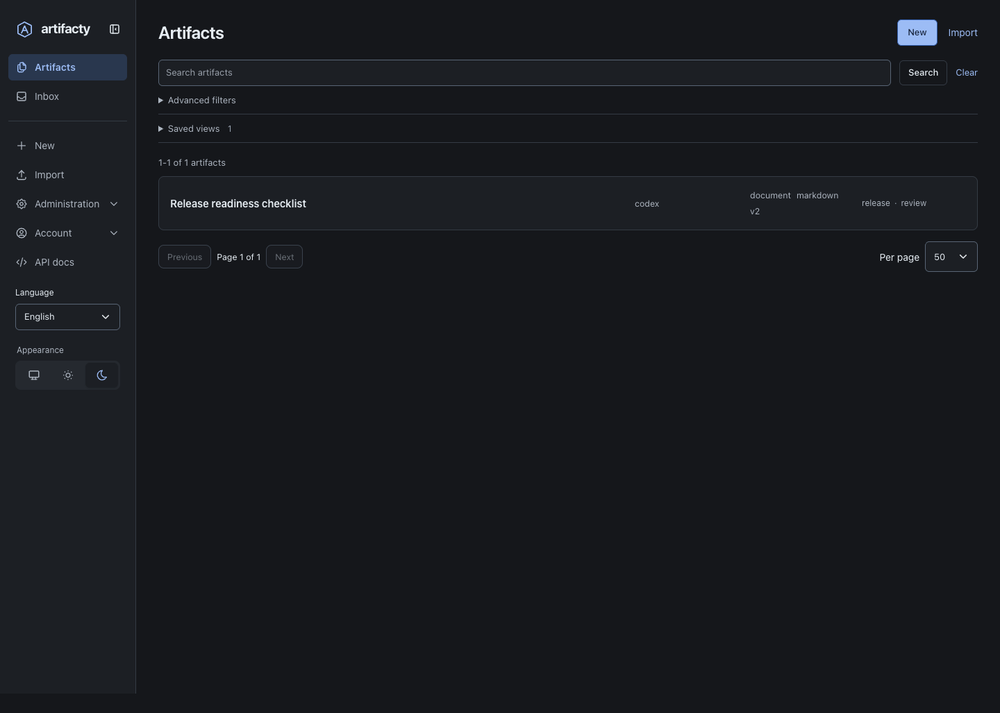

The theme control offers light, dark, and system modes. The interface remembers your choice in that browser. The sidebar can also collapse to leave more room for content.

### Display time zone

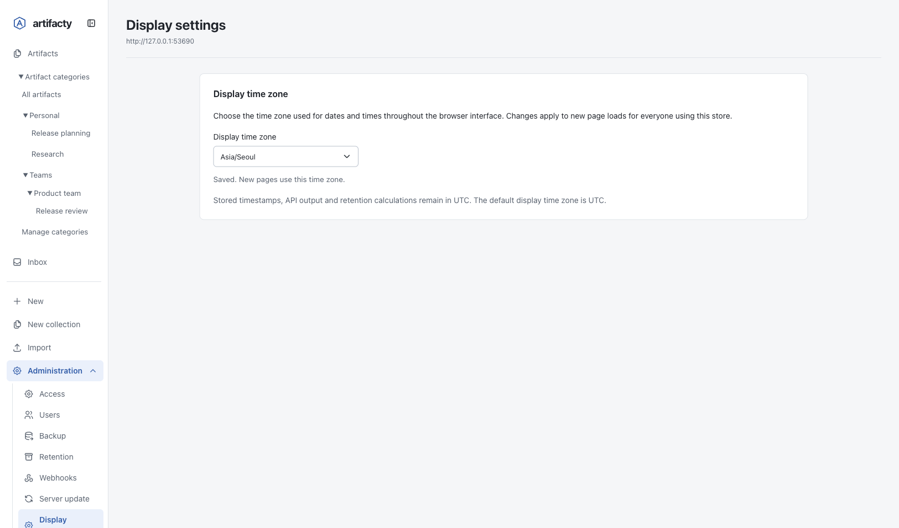

An administrator saved `Asia/Seoul` on the isolated example server. The result applies to new pages for everyone using that store.

Administrators open **Administration → Display settings** (`/admin/display`) and choose an IANA **Display time zone**, such as `Asia/Seoul` or `America/New_York`. The default is `UTC`.

With JavaScript enabled, the choice saves automatically. Wait for **Saved. New pages use this time zone.** If the result cannot be confirmed, the dropdown returns to its previous choice. Reload to check the saved value; a lost response does not mean that the server rolled back the change. Without JavaScript, select **Save display settings**. This is a store-wide administrator setting, not an individual browser preference. It applies to browser timestamps and day-based grouping when anyone opens a new page; already open pages do not update in place.

Stored timestamps, API and CLI output, and retention calculations remain in UTC. Changing the display time zone does not rewrite stored dates or alter retention deadlines. Open a new artifact or list page to verify the displayed time and day grouping.

### Import content

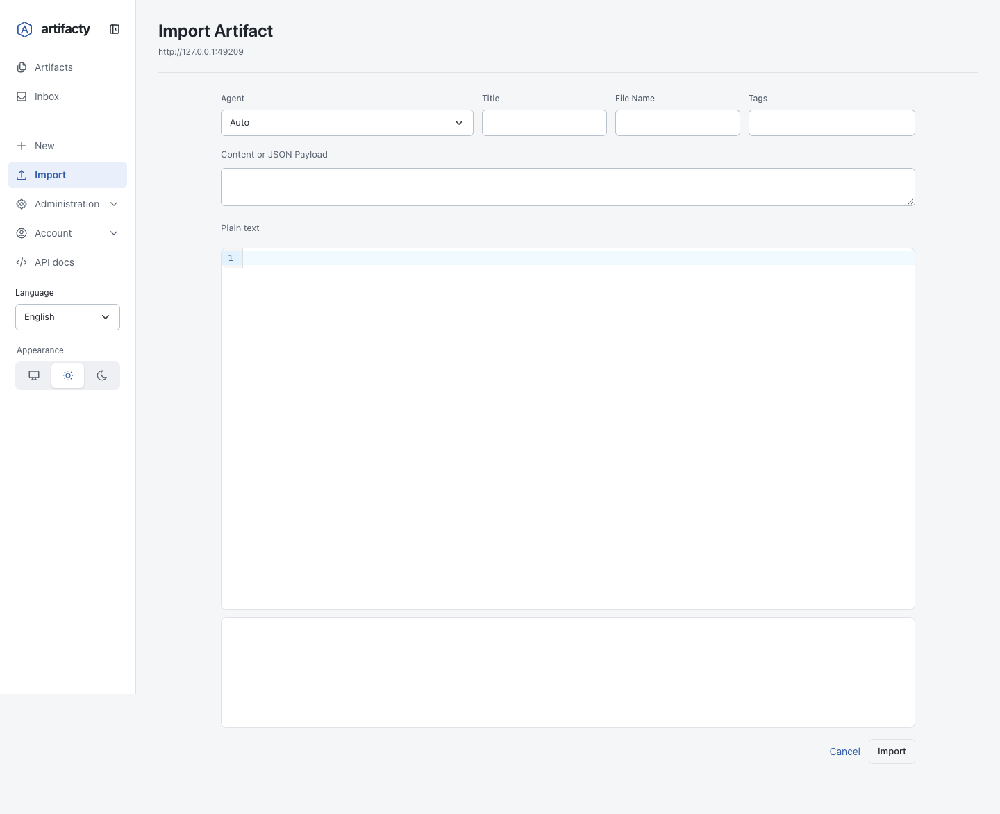

Open **Import** in the sidebar. Choose an agent format or automatic detection, paste the content, and submit the import. Check the resulting artifact title, format, and content. Import creates an artifact in the store; it is not only a preview.

### Access mode and IP restrictions

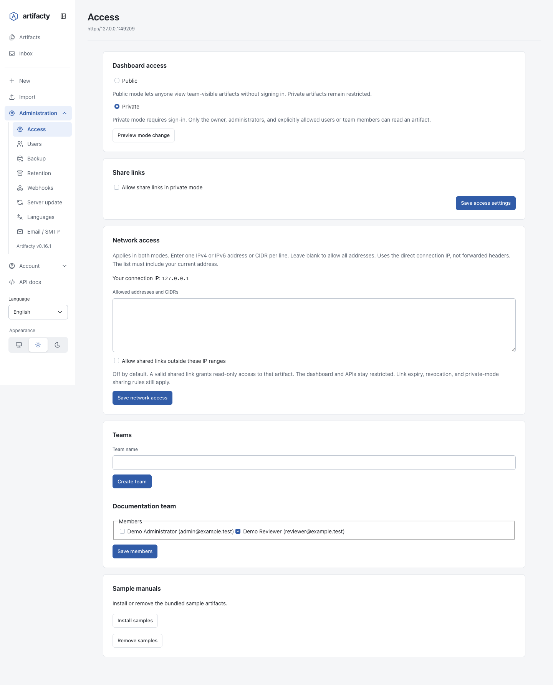

Open **Access**, select public or private mode, and use **Preview mode change** to inspect anonymous access. The preview does not save settings or simulate a particular user or team. Enter one address or CIDR per line for IP restrictions, including your current connection IP. After **Save network access**, confirm before the displayed deadline or the previous policy returns. Check both the saved policy and the intended recipient’s access.

### Users and roles

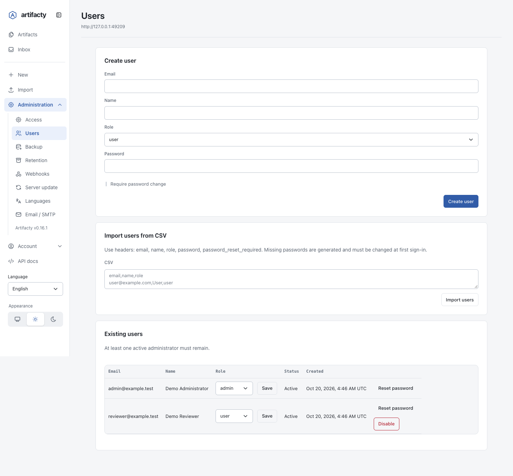

Open **Users** to create a user or change an existing role. Select **Save** in the role row and check the updated list. At least one active administrator must remain. **Reset password** creates a temporary password and ends existing sessions. Copy the password when it appears and deliver it securely; the user must change it after signing in.

### Backup and recovery

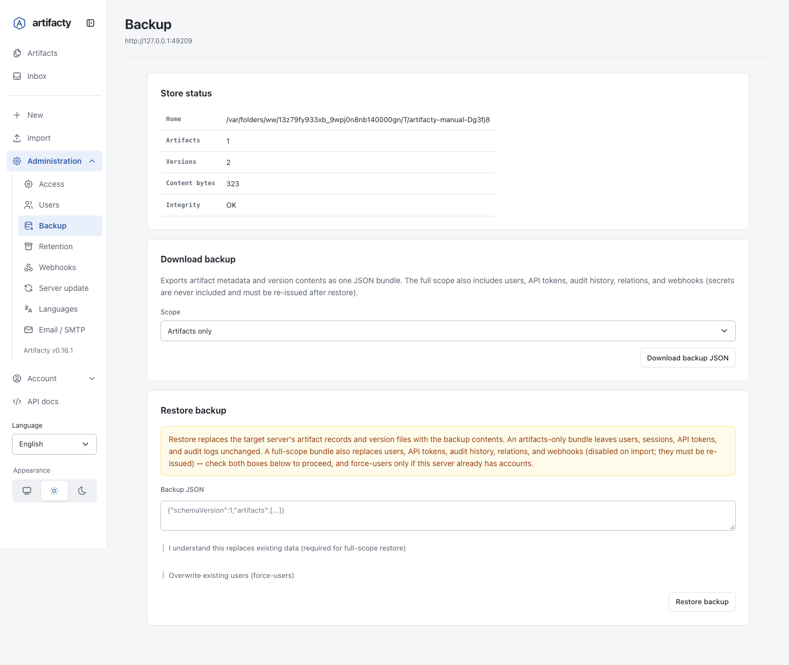

Open **Backup**, inspect integrity and the export scope, then select **Download backup JSON**. Confirm that the file downloaded. Restore replaces existing data; read the scope-specific warnings and confirmation controls before continuing. Verify recovery in an isolated store rather than testing on production. See [upgrade snapshots and recovery](upgrade-backups.md).

### Server updates

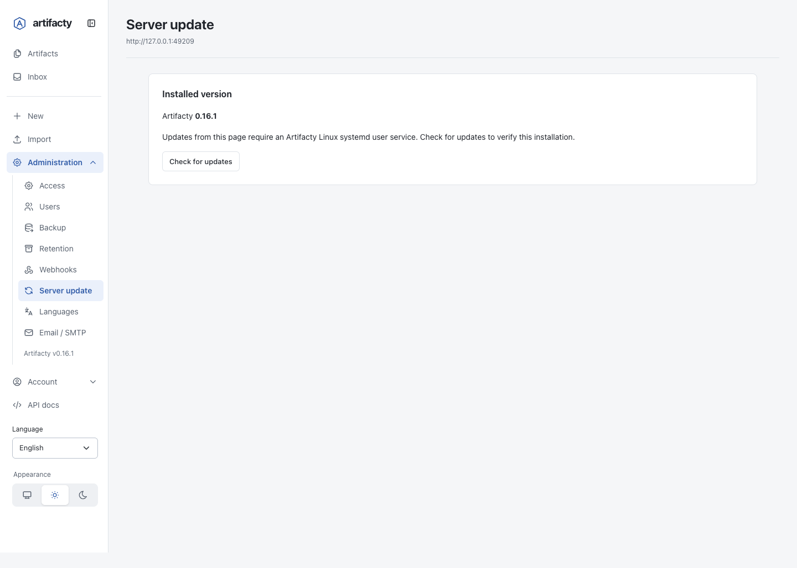

Open **Server update**, inspect the installed version, and select **Check for updates**. A current installation shows the up-to-date message. Browser updates require a supported Linux systemd user service. When an update is available, confirm the backup and server restart before starting it. After completion, refresh and check the installed version and server response. The screenshot does not represent an update actually applied for this manual.

### Retention

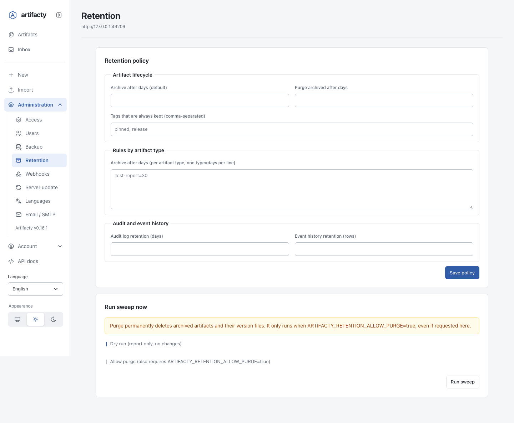

Open **Retention**, set periods and exemption tags, and select **Save policy**. First select **Dry run (report only, no changes)** and **Run sweep** to inspect candidates. Permanent purge requires both the UI permission and `ARTIFACTY_RETENTION_ALLOW_PURGE=true` on the server. After an actual sweep, check the archived and purged counts in the report.

### UI languages

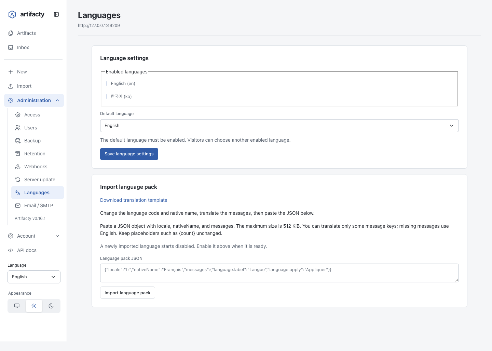

Open **Languages**, select enabled languages and the default, then select **Save language settings**. Newly imported packs start disabled; review a pack before enabling it. Check the sidebar language choices and default language. See [language packs](language-packs.md) for the format and fallback rules.

### Password reset email

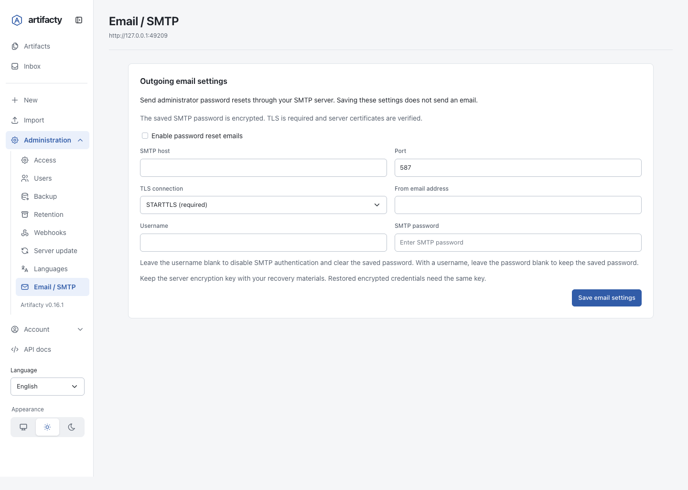

Open **Email / SMTP**, select **Enable password reset emails**, enter the host, port, TLS mode, and sender, then select **Save email settings**. Saving does not send email. The SMTP password is encrypted at rest, and the connection requires TLS with certificate verification. Verify actual reset email delivery separately: SMTP acceptance does not prove inbox delivery. See [SMTP guidance](smtp.md).

### Account and API tokens

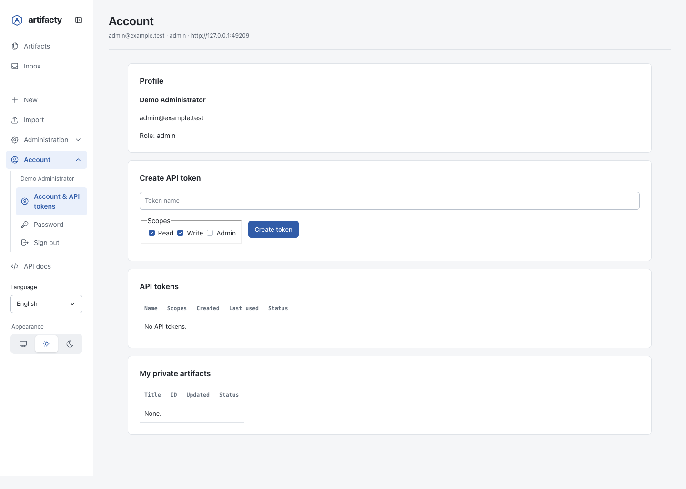

Open **Account & API tokens**, enter a token name, and select the required scopes before creating it. The full token appears only at creation. Store it securely and check its name and scopes in the list. Revoke tokens you no longer need. Never include a token in a screenshot or public document.

### Notifications

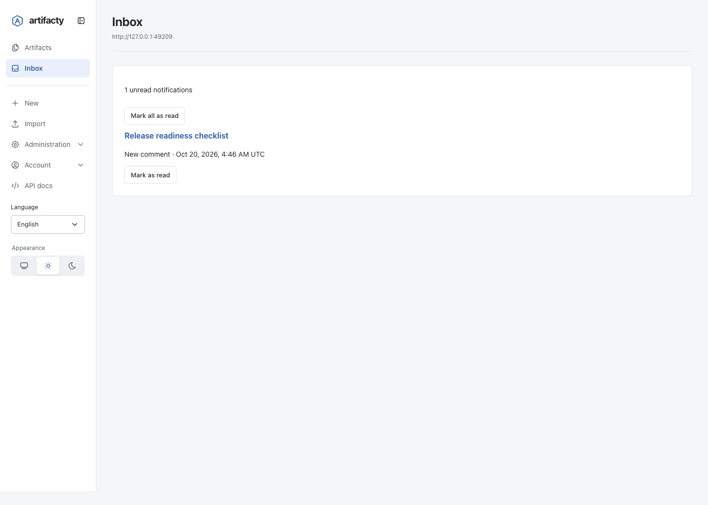

Open **Inbox** for sharing, comment, new-version, and review-request notifications. Follow an artifact title to inspect the content, then select **Mark as read**. Use **Mark all as read** to handle the list together. Check that the unread count decreases.

### Webhooks

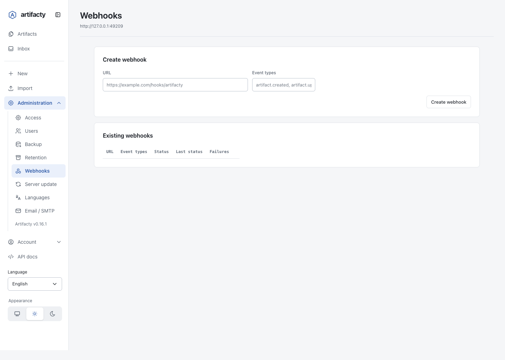

Open **Webhooks**, specify the receiving URL and event types, and select **Create webhook**. Configure the generated signing secret securely in the receiving system. Check the active state and delivery results in the list, then verify signature checking and event receipt at the receiver. A settings screenshot alone does not prove external delivery.

### API documentation

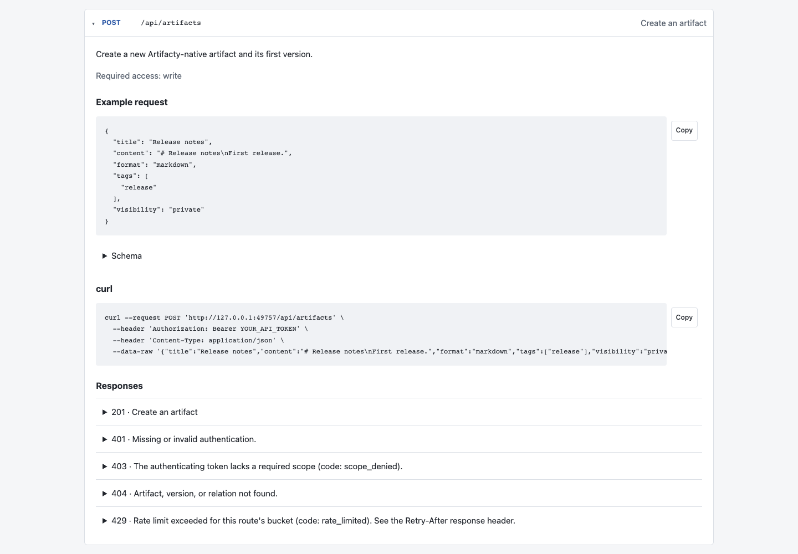

Open **API docs** in the sidebar to inspect endpoints, authentication requirements, and request examples. Confirm the server and permissions before running examples against a test store. Compare the response status and content with the documentation. API docs follow the dashboard theme.

## Check your work

After a change, verify its result on the relevant page. Check the version number after an edit, the selected filters after a search, and recipient access after sharing. For access-policy changes, follow the confirmation and rollback instructions in the administrator UI. Keep destructive maintenance and recovery separate from routine browsing.

Documentation contributors must follow the [writing style and verification rules](writing-style.md). Screenshots illustrate the interface; they do not replace permission checks or execution evidence.
